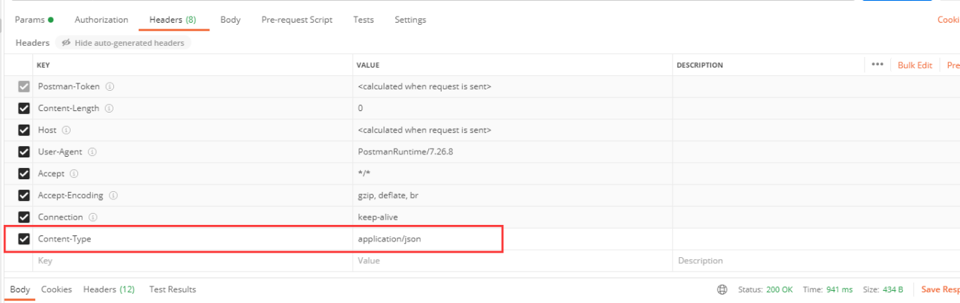
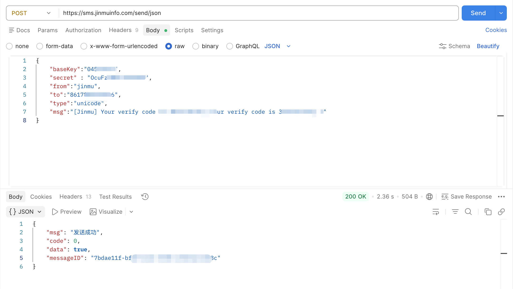
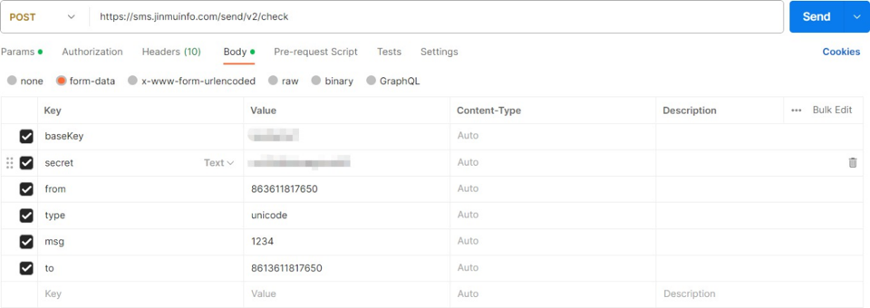
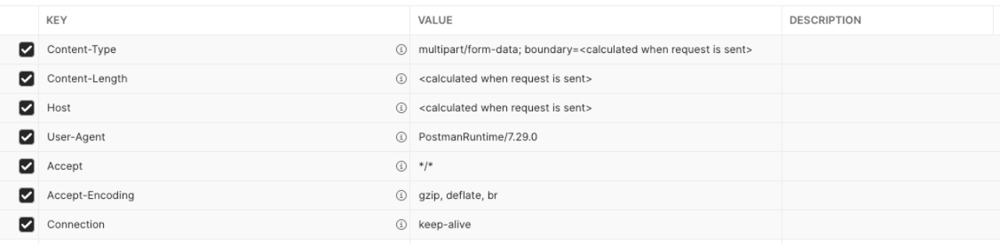
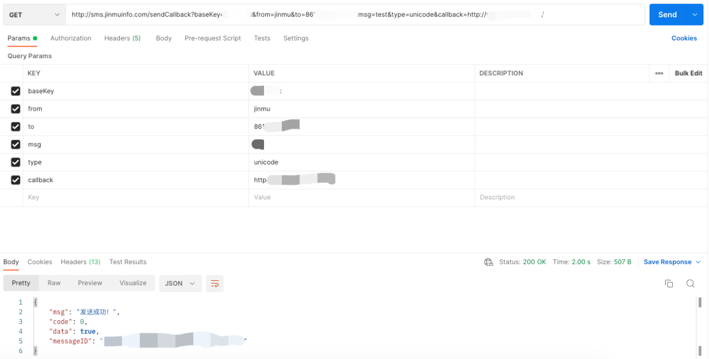
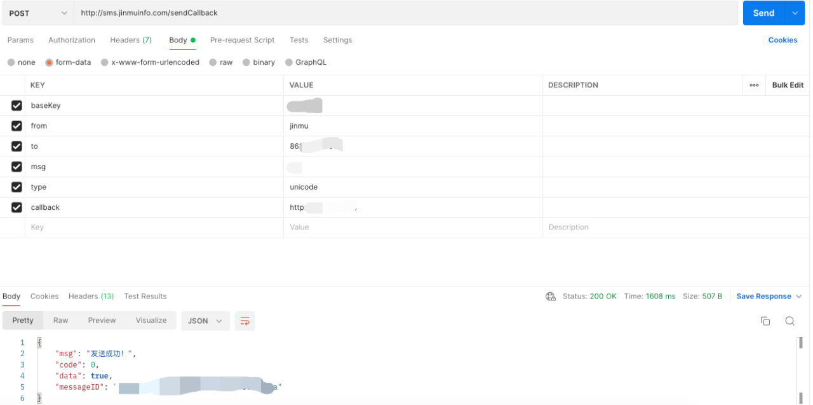

# JMC API 接入手册

短信发送、指定回调与账户余额查询接入指南

> 适用平台：JMC 发信平台  
> 适用人员：通过 API 接入短信服务的开发与运维人员  

本手册涵盖接口选择、请求参数、调用示例、响应处理和常见问题。首次接入可先完成第 1 节的接入流程，再按所选接口查看详细说明。发送前请先阅读 [字符集与 type 选择](#14-type) 和 [单条容量与长短信分段](#15)。

## 1. 接口概览

### 1.1 接入准备

从锦木通信服务团队获取 **baseKey** 和对应的 **secret**，确认账户权限、发信人和目标号码。凭据应保存在服务端，示例中的占位值使用前需替换。

建议按以下顺序完成首次接入：

1. 获取 `baseKey`、`secret`，确认允许使用的发信人、目标国家或地区以及账户余额。
2. 检查账户余额及查询接口的认证配置。
3. 按第 2 节向受控测试号码发送一条短信；中文内容设置 `type=unicode`。
4. 分别记录 HTTP 状态、业务 `code` 和返回的消息 ID，确认测试号码实际收到短信。
5. 如需指定回调，按[第 4 节](#4-webhook)联调 Webhook，并按[第 6.4 节](#64-webhook)检查回调接收情况。

### 1.2 接口选择

| 使用场景 | 请求方式与编码 | 路径 |
| :--- | :--- | :--- |
| 新版本接入短信发送 | POST，`application/json` | `/send/json` |
| 旧版发信接口 | POST，`application/x-www-form-urlencoded` | `/send/v2/check` |
| 为单次发送指定 Webhook | GET / POST；本文示例采用 POST 表单 | `/sendCallback` |
| 查询 Key 所属账户余额 | GET，URL 查询参数 | `/getBalance` |

统一服务地址：`https://sms.jinmuinfo.com`。新接入推荐使用新版 JSON 发信接口，该接口会校验号码黑名单。

### 1.3 响应字段

| 字段 | 含义 |
| :--- | :--- |
| `code` | 业务状态码，示例中 `0` 表示成功 |
| `msg` | 结果或错误说明 |
| `data` | 返回数据，示例中可能为布尔值、对象或 `null` |
| `messageID` | 发信返回的消息 ID |

### 1.4 字符集与 type 选择

发送前先检查**完整正文**，包括签名、链接和动态变量替换后的内容：

| 正文内容 | `type` | 编码及计数 |
| :--- | :--- | :--- |
| 所有字符都在 GSM 基础表或扩展表中 | `text` | GSM-7；基础字符占 1 个 GSM 单元，扩展字符占 2 个 GSM 单元 |
| 包含 GSM 字符集以外的字符 | `unicode` | 按计数单位计算；正文中的英文和数字也计入 |

中文或包含 GSM 字符集外字符的短信使用 `type=unicode`。使用 `unicode` 时，常见汉字、字母、数字和标点通常各占 1 个计数单位；部分罕见字符可能占多个单位或不受支持。英文短信也要检查实际字符是否在下方的 GSM 字符表中；短信编码后的字节数与 API 请求使用 UTF-8 传输时的字节数不同。

GSM 基础字符如下，每个占 **1 个 GSM 单元**。空格、换行符和回车符也属于基础字符：

```text
! " # $ % ' ( ) * + , - . / : ; < = > ? @ _ ¡ £ ¥ § ¿ & ¤
0 1 2 3 4 5 6 7 8 9
A B C D E F G H I J K L M N O P Q R S T U V W X Y Z
a b c d e f g h i j k l m n o p q r s t u v w x y z
Ä Å Æ Ç É Ñ Ø ø Ü ß Ö à ä å æ è é ì ñ ò ö ù ü Δ Φ Γ Λ Ω Π Ψ Σ Θ Ξ
```

GSM 扩展表中的常见字符如下，每个占 **2 个 GSM 单元**：

```text
^  {  }  [  ]  ~  \  |  €
```

例如，`€` 占 2 个单元，`£` 占 1 个单元。这里的 GSM 单元指 7 位单元（septet），不是 UTF-8 字节。

### 1.5 单条容量与长短信分段

单个 SMS 的用户数据容量为 **140 字节**。短信超过单条容量后，JMC 会拆分成多段；每段需要携带拼接头（UDH），可用于正文的容量随之减少。JMC 按发送的短信段数计费，一次 API 调用可能产生多段费用。

| 短信段数 | `text` 容量上限（GSM 单元） | `unicode` 容量上限（计数单位） |
| :--- | :--- | :--- |
| 1 段 | 160 | 70 |
| 2 段 | 306（153 × 2） | 134（67 × 2） |
| 3 段 | 459（153 × 3） | 201（67 × 3） |
| 4 段 | 612（153 × 4） | 268（67 × 4） |

超过单条容量后，首段也按长短信容量计算。表中多段数值是各段可用容量之和，实际分段还需保持字符完整；拼接头长度和通道实现也可能影响每段容量。**表格用于估算，实际段数和费用以平台记录为准。**

### 1.6 短信换行

如果短信需要分成多行，可以在正文中加入换行。例如，希望收件人看到：

```text
验证码：123456
5分钟内有效。
```

使用 JSON 请求时，在需要换行的位置填写 `\n`：

```json
{
  "baseKey": "YOUR_BASE_KEY",
  "secret": "YOUR_SECRET",
  "from": "jinmu",
  "msg": "验证码：123456\n5分钟内有效。",
  "to": "861XXXXXXXXXX",
  "type": "unicode"
}
```
### 1.7 发送前判断示例

| 短信内容 | `type` | 短信计数 | 预计段数 |
| :--- | :--- | :--- | :--- |
| `OTP: 123456` | `text` | 11 个 GSM 单元 | 1 段 |
| `Amount: €10` | `text` | 12 个 GSM 单元，其中 `€` 占 2 个单元 | 1 段 |
| `验证码：123456` | `unicode` | 10 个计数单位 | 1 段 |

发送前请检查完整正文；也可以使用下方工具计算类型和预计段数。

### 1.8 短信长度与分段计算

输入完整短信内容，即可查看建议的 `type`、字符数和预计段数。

<iframe src="../assets/sms-calculator.html?v=20261109-6" title="短信长度与分段计算" loading="lazy" style="width:100%; height:450px; border:0;"></iframe>

## 2. 新版发信接口

### 2.1 请求方式

```text
POST https://sms.jinmuinfo.com/send/json
Content-Type: application/json
```

该接口为推荐使用的新版发信接口，会校验号码黑名单。

### 2.2 请求参数

参数均位于 JSON 请求体，数据类型均为字符串。

| 参数 | 是否必填 | 说明 |
| :--- | :--- | :--- |
| `baseKey` | 是 | 加密后的 Key，由锦木通信服务团队提供 |
| `secret` | 是 | 与 baseKey 对应的密钥 |
| `from` | 是 | 发信人标识；填写账户允许使用的值 |
| `msg` | 是 | 短信正文 |
| `to` | 是 | 接收号码，包含国家或地区区号，例如 `861XXXXXXXXXX`；`+` 前缀及批量号码格式需另行确认 |
| `type` | 否 | 默认 `text`；含 GSM 字符集外字符时显式设置 `unicode`，参见第 1.4 节 |

### 2.3 Postman 设置

1. 请求方式选择 **POST**，输入上述接口地址。
2. 在 **Headers** 中设置 `Content-Type: application/json`。
3. 在 **Body → raw → JSON** 中填写请求体。



*图 1 · 新版 JSON 接口 Header 设置*

中文短信请求体示例：

```json
{
  "baseKey": "YOUR_BASE_KEY",
  "secret": "YOUR_SECRET",
  "from": "jinmu",
  "msg": "发送演示",
  "to": "861XXXXXXXXXX",
  "type": "unicode"
}
```



*图 2 · 新版 JSON 接口 POST 请求设置*

### 2.4 cURL 示例

```bash
curl "https://sms.jinmuinfo.com/send/json" \
  --header "Content-Type: application/json" \
  --data '{
    "baseKey": "YOUR_BASE_KEY",
    "secret": "YOUR_SECRET",
    "from": "jinmu",
    "msg": "发送演示",
    "to": "861XXXXXXXXXX",
    "type": "unicode"
  }'
```

将凭据、发信人和收信号码替换为实际配置；中文短信保留 `type=unicode`。

### 2.5 响应示例

业务成功示例：

```json
{
  "msg": "发送成功!",
  "code": 0,
  "data": true,
  "messageID": "xxxxx-xxxx-xxx-xxx-xxxxx"
}
```

失败：

```json
{
  "msg": "baseKey不存在或已禁用",
  "code": 35,
  "data": false
}
```

### 2.6 Java 示例

```java
public static void main(String[] args) throws Exception {
    String baseKey = "YOUR_BASE_KEY";
    String secret = "YOUR_SECRET";
    String type = "unicode";
    String from = "jinmu";
    String msg = "发送演示";
    String to = "861XXXXXXXXXX";
    JSONObject object = send(baseKey, secret, type, from, msg, to);
    System.out.println(object.toJSONString());
}

private static JSONObject send(String baseKey, String secret, String type, String from, String msg, String to) throws Exception {
    String url = "https://sms.jinmuinfo.com/send/json";
    Connection connection = Jsoup.connect(url)
            .ignoreContentType(true)
            .header("Content-Type", "application/json");

    JSONObject data = new JSONObject();
    data.put("baseKey", baseKey);
    data.put("secret", secret);
    data.put("type", type);
    data.put("from", from);
    data.put("msg", msg);
    data.put("to", to);

    connection.requestBody(data.toJSONString());
    String bodyStr = connection.method(Connection.Method.POST)
            .execute().body();
    return JSON.parseObject(bodyStr);
}
```

## 3. 旧版表单发信

### 3.1 请求方式

```text
POST https://sms.jinmuinfo.com/send/v2/check
Content-Type: application/x-www-form-urlencoded
```

旧版使用表单提交参数。已有系统采用此接口时，应保持请求方式与现有接入一致。

### 3.2 请求字段与 Postman 设置

选择 **POST**，在 **Body → x-www-form-urlencoded** 中填写下列参数。各字段的必填规则尚待确认，接入前请向锦木通信服务团队核实：

| 参数 | 说明 | 示例值 |
| :--- | :--- | :--- |
| `baseKey` | 锦木通信服务团队提供的 Key | `YOUR_BASE_KEY` |
| `secret` | 与 `baseKey` 对应的密钥 | `YOUR_SECRET` |
| `from` | 发信人标识，填写账户允许使用的值 | `jinmu` |
| `msg` | 短信正文 | `发送演示` |
| `to` | 接收号码，包含国家或地区区号 | `861XXXXXXXXXX` |
| `type` | 短信编码类型，中文内容填写 `unicode`；选择方法参见第 1.4 节 | `unicode` |



*图 3 · 旧版接口 Postman 请求示例*

截图采用 `form-data`；本节文字与代码示例采用 `application/x-www-form-urlencoded`。两种格式不同，接入前请确认接口支持的编码方式，并按对应方式设置 Postman。

### 3.3 cURL 示例

```bash
curl "https://sms.jinmuinfo.com/send/v2/check" \
  --data-urlencode "baseKey=YOUR_BASE_KEY" \
  --data-urlencode "secret=YOUR_SECRET" \
  --data-urlencode "from=jinmu" \
  --data-urlencode "msg=发送演示" \
  --data-urlencode "to=861XXXXXXXXXX" \
  --data-urlencode "type=unicode"
```

`--data-urlencode` 会使用 POST 表单请求，并对参数值进行 URL 编码。

### 3.4 黑名单响应

手机号命中黑名单：

```json
{
  "msg": "此手机号在黑名单中，无法发送",
  "code": 3333,
  "data": null
}
```

号码所属国家命中黑名单：

```json
{
  "msg": "此手机号在国家黑名单中，无法发送",
  "code": 3333,
  "data": {
    "country_code": "86",
    "country_prefix": "CN",
    "country_name": "China (PRC)"
  }
}
```

### 3.5 Java 示例

```java
public static void main(String[] args) throws Exception {
    String baseKey = "YOUR_BASE_KEY";
    String secret = "YOUR_SECRET";
    String type = "unicode";
    String from = "jinmu";
    String msg = "发送演示";
    String to = "861XXXXXXXXXX";
    JSONObject object = send(baseKey, secret, type, from, msg, to);
    System.out.println(object.toJSONString());
}

private static JSONObject send(String baseKey, String secret, String type, String from, String msg, String to) throws Exception {
    String url = "https://sms.jinmuinfo.com/send/v2/check";
    Connection connection = Jsoup.connect(url).ignoreContentType(true);
    Map<String, String> data = new HashMap<>();
    data.put("baseKey", baseKey);
    data.put("secret", secret);
    data.put("type", type);
    data.put("from", from);
    data.put("msg", msg);
    data.put("to", to);
    connection.data(data);
    String bodyStr = connection.method(Connection.Method.POST)
            .execute().body();
    return JSON.parseObject(bodyStr);
}
```

## 4. 指定 Webhook 发信

### 4.1 请求方式

```text
GET / POST https://sms.jinmuinfo.com/sendCallback
```

该接口用于为本次发信指定 Webhook 地址，同时支持 GET 和 POST，推荐使用 POST。

### 4.2 请求参数

GET 请求通过 URL 查询参数传递数据；本文的 POST 示例使用表单提交。POST 请求支持的参数位置与编码方式尚待确认，接入前请向锦木通信服务团队核实。

| 参数 | 是否必填 | 说明 |
| :--- | :--- | :--- |
| `baseKey` | 是 | 锦木通信服务团队提供的 Key |
| `from` | 是 | 发信人标识；填写账户允许使用的值 |
| `msg` | 是 | 短信正文 |
| `to` | 是 | 接收号码，包含区号 |
| `type` | 否 | 默认 `text`；含 GSM 字符集外字符时显式设置 `unicode`，参见第 1.4 节 |
| `callback` | 是 | 本次发信的 Webhook 地址，仅支持 HTTP 或 HTTPS |

回调地址示例：`https://example.com/webhooks/sms`。该地址应可从公网访问，并有应用接收请求。平台通过 POST 请求发送回调，回调数据为 JSON 格式。

### 4.3 Postman 示例

以下为 Header、GET 和 POST 请求的 Postman 设置示例：



*图 4 · 指定回调接口 Header 示例*



*图 5 · 指定回调接口 GET 请求示例*



*图 6 · 指定回调接口 POST 请求示例*

### 4.4 cURL 示例

以下示例使用 POST 请求，并以 `application/x-www-form-urlencoded` 格式提交参数：

```bash
curl "https://sms.jinmuinfo.com/sendCallback" \
  --data-urlencode "baseKey=YOUR_BASE_KEY" \
  --data-urlencode "from=jinmu" \
  --data-urlencode "msg=发送演示" \
  --data-urlencode "to=861XXXXXXXXXX" \
  --data-urlencode "type=unicode" \
  --data-urlencode "callback=https://example.com/webhooks/sms"
```

将 `baseKey` 和 `callback` 替换为实际配置。

### 4.5 响应示例

业务成功示例：

```json
{
  "msg": "发送成功!",
  "code": 0,
  "data": true,
  "messageID": "xxx-xxx-xxx-xxx"
}
```

失败：

```json
{
  "msg": "baseKey不存在或已禁用",
  "code": 35,
  "data": false,
  "messageID": null
}
```

### 4.6 Java 示例

```java
public static void main(String[] args) throws Exception {
    String baseKey = "YOUR_BASE_KEY";
    String type = "unicode";
    String from = "jinmu";
    String msg = "发送演示";
    String to = "861XXXXXXXXXX";
    String callback = "https://example.com/webhooks/sms";
    JSONObject object = send(baseKey, type, from, msg, to, callback);
    System.out.println(object.toJSONString());
}

private static JSONObject send(String baseKey, String type, String from, String msg, String to, String callback) throws Exception {
    String url = "https://sms.jinmuinfo.com/sendCallback";
    Connection connection = Jsoup.connect(url).ignoreContentType(true);
    Map<String, String> data = new HashMap<>();
    data.put("baseKey", baseKey);
    data.put("type", type);
    data.put("from", from);
    data.put("msg", msg);
    data.put("to", to);
    data.put("callback", callback);
    connection.data(data);
    String bodyStr = connection.method(Connection.Method.POST)
            .execute().body();
    return JSON.parseObject(bodyStr);
}
```

## 5. 账户余额查询

### 5.1 请求方式

```text
GET https://sms.jinmuinfo.com/getBalance
```

用于查询 API Key 所属账户的余额。

### 5.2 请求参数

| 参数 | 是否必填 | 说明 |
| :--- | :--- | :--- |
| `baseKey` | 是 | 锦木通信服务团队提供的 Key |
| `secret` | 按账户配置 | 是否需要传入，请向锦木通信服务团队确认 |

参数位于 URL 查询部分。查询结果中，`data.balance` 为余额，`data.currency` 为货币标识。

### 5.3 cURL 示例

```bash
curl --get "https://sms.jinmuinfo.com/getBalance" \
  --data-urlencode "baseKey=YOUR_BASE_KEY"
```

如账户配置要求提供密钥，在命令中追加 `--data-urlencode "secret=YOUR_SECRET"`。

### 5.4 响应示例

业务成功示例：

```json
{
  "msg": "请求成功",
  "code": 0,
  "data": {
    "balance": 100.00000,
    "currency": "$"
  }
}
```

认证失败：

```json
{
  "msg": "认证失败",
  "code": 34,
  "data": false
}
```

Key 不存在：

```json
{
  "msg": "baseKey不存在",
  "code": 35,
  "data": false
}
```

## 6. 状态码与问题排查

### 6.1 HTTP 状态码

HTTP 状态码说明如下：

| HTTP 状态 | 说明 |
| :--- | :--- |
| `200` | OK，仍需检查响应体中的业务 `code` |
| `401` | Unauthorized，认证未通过 |
| `403` | Forbidden，请求被拒绝 |
| `404` | Not Found，接口路径未找到 |

### 6.2 业务状态码

| `code` | 含义 | 优先检查 |
| :--- | :--- | :--- |
| `0` | 成功 | 保存返回数据及消息 ID |
| `23` | callback 地址无效 | URL 格式及 HTTP / HTTPS 协议 |
| `34` | 认证失败 | Key、Secret 及账户配置 |
| `35` | baseKey 不存在或已禁用 | Key 是否正确、是否被禁用 |
| `3333` | 命中号码或国家黑名单 | 对应 Key 下的黑名单配置 |

以上为本文已列出的业务状态码，不代表所有接口均返回同一套错误码。

### 6.3 常见问题定位

| 现象 | 检查方法 |
| :--- | :--- |
| HTTP 返回成功，但业务失败 | 检查响应体 `code` 与 `msg`，不能只判断 HTTP `200` |
| 正文出现乱码或问号 | 检查完整正文是否包含 GSM 表外字符；如有则设置 `type=unicode`，并核对 HTTP 请求编码 |
| 英文短信段数超出预期 | 检查弯引号、长破折号、GSM 扩展符号，以及平台是否追加签名；按第 1.5 节重新估算 |
| 短信没有按预期换行 | 检查正文是否包含换行；JSON 请求可参考第 1.6 节的示例 |
| 认证失败 | 确认凭据属于同一 Key，检查空格、Key 状态及版本要求 |
| 消息 ID 未解析到 | 检查字段名 `messageID` 的大小写；允许失败响应不含 ID 或值为 `null` |
| 请求超时，发送结果不明确 | 先核查服务端或回执记录；接口的幂等保障尚待确认，直接重试可能重复发送 |

### 6.4 未收到 Webhook

1. 检查 `callback` 是否为有效的 HTTP 或 HTTPS 地址。
2. 若业务响应为 `code = 23`，先修正回调 URL。
3. 若响应正常但没有回调，检查目标 IP 或域名是否可访问、端口是否开放。
4. 确认接收 Webhook 的应用已启动，并检查应用接收日志。

## 7. 参考资料

- [Vonage：Concatenation and Encoding](https://developer.vonage.com/en/messaging/sms/guides/concatenation-and-encoding) — 字符集、编码选择、单条容量、换行及平台长度说明。
