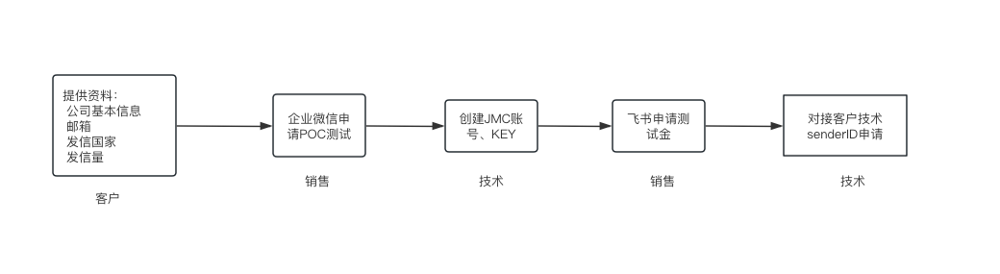
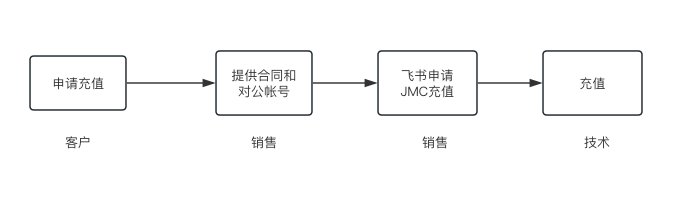

# 平台概述

锦木通信平台（以下称“JMC”）是由上海锦木信息技术有限公司（以下简称“锦木信息”）结合众多全球化业务客户需求和锦木信息多年一线服务经验研发的通信服务 SaaS 平台。

JMC 目前已全面支持国内外短信服务业务，该业务对接锦木信息核心合作伙伴 Vonage（Nexmo 及 TokBox 现已成为 Vonage 的旗下公司）全球云通讯信息渠道，可达到“国内短信验证秒级触达，99% 到达率；国际/港澳台短信覆盖全球 200+ 国家/地区”的标准，快速稳定可靠。后续逐步开放社交媒体、语音和视频等业务支持。

以下内容均特指 JMC 的短信服务操作指南。

JMC 短信服务业务支持营销类、交易类两种类型短信。其中营销类短信不仅支持平台发信，简便快捷，也支持 API 发信；交易类短信仅支持 API 发信。

JMC 平台支持单用户亿条短信并发，分钟级千万条日志导出。

## 1 业务办理流程

### 1.1 首次接入

用户向锦木通信服务团队提供相关接入信息，后续审核、申请及维护工作由服务团队负责。接入流程如下图所示。

### 1.2 新增发信国家或地区

不同国家或地区的政策要求有所差异，部分目的地须提前申请，相关要求记录在“接入信息表—表 2”中。计划新增发信国家或地区时，请提前联系锦木通信服务团队确认，避免影响任务正常发送。

### 1.3 账户充值

JMC 暂不支持平台自助充值，用户须通过汇款或转账充值。具体方式请咨询对接的锦木销售人员，流程如下图所示。

## 2 名词解释

**短信服务**：锦木通信平台提供的通信业务服务，覆盖全球 200 多个国家或地区。支持从中国境内向港澳台及其他境外手机号码发送短信，也支持在境外向境外手机号码发送短信。

**From**：发信方号码。不同国家或地区要求不同，锦木通信服务团队可协助开通。

**Sender ID**：部分国家允许将 From 数字号码替换为字母型 Sender ID，须提前申请。美国发信须申请，但实际发送仍使用数字 From。锦木通信服务团队可协助申请和设置；具体适用要求请联系服务团队确认。

**短信签名**：位于短信正文前、包含在 `【】` 中的署名，用于标识公司或业务，例如 `【Jinmu】`。不同国家或地区要求不同，由锦木通信服务团队协助申请和设置。

**短信模板**：具体发送的短信正文内容。

**长短信**：短信长度超过相应字符限制后，会拆分为多条发送并计费。部分国家的接收端会将拆分短信合并为一条展示，部分国家则展示为多条。

**营销类短信**：含有营销推广意图的短信，常见于促销、会员活动、会员关怀、新品上线提醒和活动通知等场景。

**交易类短信**：包括验证码短信和通知类短信，例如注册登录验证、支付确认、身份核实、付款回执、物流通知和状态提醒。

## 3 JMC功能模块及描述

<table>
    <tr>
        <th>功能模块</th>
        <th>功能项</th>
        <th>描述</th>
    </tr>
    <tr>
        <td rowspan="3">登录 / 首页</td>
        <td>登录</td>
        <td>支持邮箱/手机号（中国大陆及港澳台、新加坡、美国）登录。</td>
    </tr>
    <tr>
        <td>忘记密码</td>
        <td>通过邮箱或手机号获取验证码进行修改账号密码。</td>
    </tr>
    <tr>
        <td>通知</td>
        <td>查看平台通知信息。</td>
    </tr>
    <tr>
        <td rowspan="2">任务管理</td>
        <td>国际</td>
        <td>支持所有国家/地区的发信。</td>
    </tr>
    <tr>
        <td>任务统计</td>
        <td>包含所有 JMC 平台上创建的任务发信数据统计。</td>
    </tr>
    <tr>
        <td rowspan="4">模板管理</td>
        <td>国际</td>
        <td>支持创建所有国家短信模板。</td>
    </tr>
    <tr>
        <td>Webhook URL</td>
        <td>配置发信Webhook接收地址,还能配置自定义验证请求头。</td>
    </tr>
    <tr>
        <td>Webhook回执</td>
        <td>为平台任务指定特殊的webhook回调地址。</td>
    </tr>
    <tr>
        <td>kye管理</td>
        <td>管理账号中自己key的secret。</td>
    </tr>
    <tr>
        <td rowspan="5">日志管理</td>
        <td>日志查询</td>
        <td>支持查询营销类、交易类短信详细条目，自助导出 csv、xlsx 文件格式。</td>
    </tr>
    <tr>
        <td>新版日志查询</td>
        <td>新版日志查询，包含使用应用发信的日志信息。</td>
    </tr>
    <tr>
        <td>voice日志查询</td>
        <td>查询语音的日志记录。</td>
    </tr>
    <tr>
        <td>webhook日志查询</td>
        <td>用户可以查询发信的outbound 与 inbound webhook日志。</td>
    </tr>
    <tr>
        <td>报告下载</td>
        <td>统计型数据展示，支持按类型、时间区域、国家等多维度查询及导出。</td>
    </tr>
    <tr>
        <td>下载中心</td>
        <td>文件下载</td>
        <td>统一下载发信日志文件。</td>
    </tr>
    <tr>
        <td>个人中心</td>
        <td>账号信息</td>
        <td>查看账号信息并修改密码。</td>
    </tr>
    <tr>
        <td>黑名单</td>
        <td>国家及手机号黑名单</td>
        <td>分为国家/地区黑名单与手机号码黑名单,被黑名单拦截的号码不进行发送。</td>
    </tr>
    <tr>
        <td rowspan="2">号码管理</td>
        <td>您的号码</td>
        <td>查看和管理用户拥有号码。</td>
    </tr>
    <tr>
        <td>购买号码</td>
        <td>能够选择不同国家的号码进行购买。</td>
    </tr>
</table>

