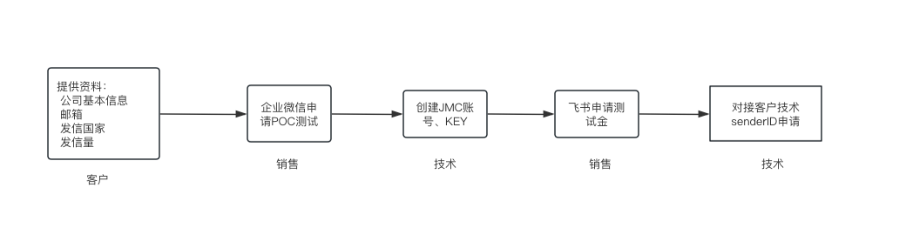
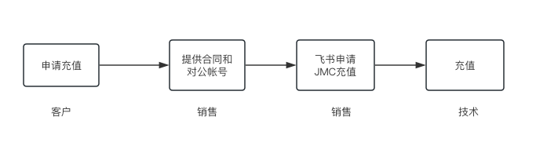
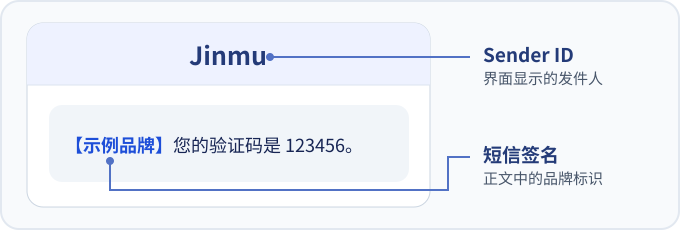

# 产品介绍

锦木通信平台（以下称“JMC”）是由上海锦木信息技术有限公司（以下简称“锦木信息”）结合众多全球化业务客户需求和锦木信息多年一线服务经验研发的通信服务 SaaS 平台。

JMC 目前已全面支持国内外短信服务业务，该业务对接锦木信息核心合作伙伴 Vonage（Nexmo 及 TokBox 现已成为 Vonage 的旗下公司）全球云通讯信息渠道，可达到“国内短信验证秒级触达，99% 到达率；国际/港澳台短信覆盖全球 200+ 国家/地区”的标准，快速稳定可靠。后续逐步开放社交媒体、语音和视频等业务支持。

JMC 支持从中国境内向港澳台及其他境外手机号码发送短信，也支持从境外向境外手机号码发送短信。

JMC 平台支持单用户亿条短信并发，分钟级千万条日志导出。

## 1. 业务办理流程

### 1.1 首次接入

用户向锦木通信服务团队提供相关接入信息，后续审核、申请及维护工作由服务团队负责。接入流程如下图所示。

### 1.2 新增发信国家或地区

不同国家或地区的政策要求有所差异，部分目的地须提前申请，相关要求记录在“接入信息表—表 2”中。计划新增发信国家或地区时，请提前联系锦木通信服务团队确认，避免影响任务正常发送。发信前可先查看[各国和地区发信规则](#5)。

### 1.3 账户充值

JMC 暂不支持平台自助充值，用户须通过汇款或转账充值。具体方式请咨询对接的锦木销售人员，流程如下图所示。

## 2. 短信基础概念

### 2.1 短信类型

| 类型 | 常见用途 | 发送方式 |
| :--- | :--- | :--- |
| 营销类短信 | 促销、会员活动、新品提醒等 | 网页平台或 API |
| 交易类短信 | 验证码、支付确认、物流通知、状态提醒等 | API |

### 2.2 短信签名、模板和 Sender ID

假设收件人的手机界面顶部显示 `Jinmu`，短信内容为 `【示例品牌】您的验证码是 123456。`。

| 名词 | 含义 | 示例 |
| :--- | :--- | :--- |
| `from` | API 请求中填写的发件人标识，可使用账户允许的数字号码或字母型标识 | `Jinmu` |
| Sender ID | 收件人看到的发件人标识，通常显示在短信界面顶部 | `Jinmu` |
| 短信签名 | 短信正文中标识品牌或业务的文字 | `【示例品牌】` |
| 短信模板 | 可重复使用的预设正文，可包含发送时替换的变量 | `【示例品牌】您的验证码是 {验证码}。` |

Sender ID 支持的格式、长度、是否需要注册，以及收件端能否显示原标识，取决于目的地、运营商和发信通道。部分国家或地区也要求提前申请短信签名或模板，发信前请确认适用要求。

### 2.3 锦木 baseKey

`baseKey` 是 JMC 提供的 API 访问凭据。请在服务端妥善保管，并按接口要求填写认证参数。详见 [API 接入手册](api.md)。

### 2.4 长短信

短信正文超过单条容量时，JMC 会拆分成多段发送，并按发送段数计费。收件人的手机可能将多段合并显示，也可能逐段显示，具体取决于通道和终端。

| `type` | 适用内容 | 单条容量 | 长短信每段参考容量 |
| :--- | :--- | :--- | :--- |
| `text` | 内容全部在 GSM 字符集中 | 160 个 GSM 单元 | 153 个 GSM 单元 |
| `unicode` | 含中文或其他 GSM 字符集外字符 | 70 个计数单位 | 67 个计数单位 |

按表中的容量估算，正文只有 70 个常见汉字时发 1 段，增加到 71 个汉字时发 2 段。超过单条容量后，首段也按长短信容量计算。使用 `text` 时，`€` 等 GSM 扩展字符会占用两个 GSM 单元。

请把签名、空格、标点和替换变量后的文字一起输入[短信长度与分段计算工具](api.md#18)。实际段数和费用以平台记录为准。

### 2.5 入站短信与送达回执

如需接收入站短信或送达回执，请联系锦木通信服务团队配置 Webhook。

| 推送内容 | 含义 |
| :--- | :--- |
| 入站短信（Inbound） | 平台收到的短信，例如收件人主动回复的内容。 |
| 送达回执 | 通道返回的短信投递状态，例如已送达或投递失败。 |

配置完成后，JMC 会通过 HTTP POST 将回调推送到指定地址，数据格式为 JSON。

### 2.6 调用率、发送率和送达率

| 指标 | 统计阶段 | 计算方式 |
| :--- | :--- | :--- |
| 调用率（API 调用成功率） | 客户端调用 JMC API | 成功请求数 ÷ 请求总数。根据 HTTP 状态和业务响应判断请求是否成功。 |
| 发送率 | JMC 将短信提交给短信通道 | 通道接收数 ÷ JMC 接收数。 |
| 送达率 | 通道投递短信并返回状态 | 回执标记为送达的数量 ÷ 下发到通道的数量。 |

比较两份报表时，请选择相同的时间范围。计算送达率时，两个数字要用同一种方式来数。例如，如果报表按短信段数统计，就用已送达的段数除以提交给短信通道的段数。报表是按短信条数、段数还是收信号码数来统计，以及没收到回执时怎么算，请查看报表说明。

## 3. JMC 功能模块

<table>
    <tr>
        <th>功能模块</th>
        <th>功能项</th>
        <th>描述</th>
    </tr>
    <tr>
        <td rowspan="3">登录 / 首页</td>
        <td>登录</td>
        <td>支持邮箱/手机号（中国大陆及港澳台、新加坡、美国）登录。</td>
    </tr>
    <tr>
        <td>忘记密码</td>
        <td>通过邮箱或手机号获取验证码进行修改账号密码。</td>
    </tr>
    <tr>
        <td>通知</td>
        <td>查看平台通知信息。</td>
    </tr>
    <tr>
        <td rowspan="2">任务管理</td>
        <td>国际</td>
        <td>向已开通的国家或地区发送短信。</td>
    </tr>
    <tr>
        <td>任务统计</td>
        <td>包含所有 JMC 平台上创建的任务发信数据统计。</td>
    </tr>
    <tr>
        <td rowspan="4">模板管理</td>
        <td>国际</td>
        <td>创建国际及港澳台短信模板。</td>
    </tr>
    <tr>
        <td>Webhook URL</td>
        <td>请先联系锦木通信服务团队配置 Webhook。开通后，可在此编辑回调地址和自定义验证请求头。</td>
    </tr>
    <tr>
        <td>Webhook 回执</td>
        <td>为平台发信任务指定回调地址。</td>
    </tr>
    <tr>
        <td>用户 Key</td>
        <td>查看账户的 baseKey 和 secret。</td>
    </tr>
    <tr>
        <td rowspan="5">日志管理</td>
        <td>日志查询</td>
        <td>支持查询营销类、交易类短信详细条目，自助导出 csv、xlsx 文件格式。</td>
    </tr>
    <tr>
        <td>新版日志查询</td>
        <td>新版日志查询，包含使用应用发信的日志信息。</td>
    </tr>
    <tr>
        <td>语音日志查询</td>
        <td>查询语音的日志记录。</td>
    </tr>
    <tr>
        <td>Webhook 日志查询</td>
        <td>查询送达回执和入站短信的 Webhook 日志。</td>
    </tr>
    <tr>
        <td>报告下载</td>
        <td>统计型数据展示，支持按类型、时间区域、国家等多维度查询及导出。</td>
    </tr>
    <tr>
        <td>下载中心</td>
        <td>文件下载</td>
        <td>统一下载发信日志文件。</td>
    </tr>
    <tr>
        <td>个人中心</td>
        <td>账号信息</td>
        <td>查看账号信息并修改密码。</td>
    </tr>
    <tr>
        <td>黑名单</td>
        <td>国家及手机号黑名单</td>
        <td>分为国家/地区黑名单与手机号码黑名单,被黑名单拦截的号码不进行发送。</td>
    </tr>
    <tr>
        <td rowspan="2">号码管理</td>
        <td>您的号码</td>
        <td>查看和管理用户拥有号码。</td>
    </tr>
    <tr>
        <td>购买号码</td>
        <td>购买号码请联系锦木通信服务团队办理。</td>
    </tr>
</table>

## 4. 发信流程

### 4.1 提交与查询

1. **提交发信。** 在 JMC 网页平台创建发信任务，或通过 API 提交请求。
2. **通道接收。** JMC 将符合发送条件的短信提交给短信通道，由通道继续投递。
3. **查询结果。** 平台发信记录、单条短信和 API 发信记录都可在 **日志管理 → [日志查询](platform-usage.md#51)** 中查看。

接口返回成功后，请查看短信日志或 Webhook 送达回执，确认短信是否送达。

### 4.2 发送速率

API 调用速率与通道发送速率分别衡量每秒请求数和每秒发送量。具体上限和计量单位取决于账户配置、发信通道及业务场景。如需确认或调整速率，请联系锦木通信服务团队。

## 5. 各国和地区发信规则

### 5.1 查看所有国家和地区的规则

[查看完整规则](sender-id.md)

### 5.2 中国大陆

- **签名和模板。** 发信前须报备简体中文签名和短信模板。正文使用简体中文，并把签名放在开头，如 `【示例品牌】 您的验证码是 123456`。自 2026 年 10 月 29 日起，已报备的签名和模板也须重新提交。修改已报备的正文时，需要重新报备。
- **收件人看到的发件人。** 通过报备通道发送时，收件人通常会看到以 `1069` 开头的数字号码。
- **发送频率。** 24 小时内向同一号码发送相同内容，通常最多约 3 条。发送不同内容，通常最多约 15 条。超过限制的短信可能被运营商拦截。

### 5.3 中国香港

运营商 45407（ChinaUnicomHK）和 45412（ChinaMobileHK）：
默认不支持字母型 Sender ID 透传，需要申请。不申请的话，所有 Sender ID 会被替换成香港本地手机号去确保送达。

运营商 CSL（45400）、Hutchison（45404）、SmarTone（45406）和 PCCW（45416）：
默认支持 3-11 字符长度的字母型 Sender ID 透传，非字母型 Sender ID 会被替换成香港本地号码或“SMS”。

### 5.4 中国台湾

Sender ID 会被替换为台湾本地号码。如需使用字母型 Sender ID，可申请直连通道，费用可能不同。

GSM-7 编码的短信中，`| ^ € { } [ ] ~ \` 这些字符会被替换成 `△`，`<` 和 `>` 可正常显示。

填写收信号码时，使用地区代码 `886`，并去掉本地手机号开头的 `0`。

营销短信含链接时，需提前报备，未报备的短信可能受限。正文不含链接时，可在通道限制范围内发送。

### 5.5 中国澳门

运营商 SmarTone（45500）、CTM（45501）和 Hutchison（45503）支持动态字母型 Sender ID，不需要申请；运营商 China Telecom 会被换成随机的香港号码。

### 5.6 美国

向美国发送短信时，使用已开通短信服务的数字号码。常见选择如下。

| 发信号码类型 | 发送前需要办理的事项 |
| :--- | :--- |
| 10DLC（十位本地号码） | 注册品牌（Brand）和短信使用场景（Campaign），通过审核后再发送。 |
| 免费电话号码（Toll-Free） | 提交号码及短信用途，通过验证后再发送。 |
| 专用短码（Dedicated Short Code） | 申请专用短码，并提交短信用途供审核。 |

营销短信、验证码和业务通知都可根据用途选择合适的号码类型。发信前请向锦木通信服务团队确认可用号码、申请材料及审核时间。

### 5.7 菲律宾

需要注册 Sender ID。如果不注册 Sender ID 的话，会被转换成随机的通用 Sender ID（nxsms）或者号码，且低于注册了 Sender ID 的送达率。注册 Sender ID 需要客户签署授权书（在授权书上填写信息签字盖章，并扫描发给我们。涉及 2 个运营商：Smart 和 Globe）。

### 5.8 韩国

- **Sender ID。** 客户填写的字母型或数字型 Sender ID 都会被替换成数字长号码。
- **短信前缀。** 通道会自动添加 `[Web 발신]`（来自网络）或 `[국제발신]`（来自境外），单条短信可容纳 140 个 GSM-7 基础字符或约 70 个常见韩文字，自动添加的前缀也占用这部分容量。
- **长短信。** 默认通道可能将长短信拆成多条或截断，分段也可能乱序。如需以一条完整短信送达，请提前确认是否支持韩国长短信服务（LMS）。
- **营销短信。** 短信开头应标明 `(광고)`（广告），末尾应提供 `수신거부`（退订）说明和退订号码。
