# JMC 平台使用指南

Whaleal JMC 发信平台支持短信任务创建、发送结果查询、模板管理、日志导出及黑名单配置。本指南按平台功能说明操作方式与使用限制，适用于通过网页平台发送短信和查询发送记录的用户。

平台入口：[https://client.jinmuinfo.com](https://client.jinmuinfo.com)

## 1 登录与账号

### 1.1 登录前准备

- **账号开通**：账号须由锦木通信服务团队注册。手机号登录暂支持中国大陆、港澳台及新加坡号码。
- **初始密码**：账号注册时，系统会将密码发送至注册邮箱。
- **验证码**：邮箱登录时发送至邮箱；手机号登录时通过短信发送。验证码有效期为 **5 分钟**。

### 1.2 登录方式

1. 打开平台登录页，选择邮箱登录或手机号登录。
2. 输入账号和密码。使用手机号登录时，先选择区号，再输入手机号，无须重复填写区号。
3. 查收邮箱或手机短信中的验证码，并在有效期内完成登录。

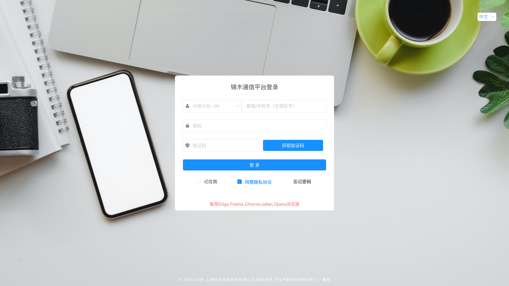

*图 1-1 平台登录页*

### 1.3 常见登录问题

**账号或密码有误**：检查账号、密码及手机号区号。确认无误后仍无法登录，可使用“忘记密码”重置密码，或联系锦木通信服务团队协助处理。

**提示 `access for api meet limit`**：稍后再尝试登录。

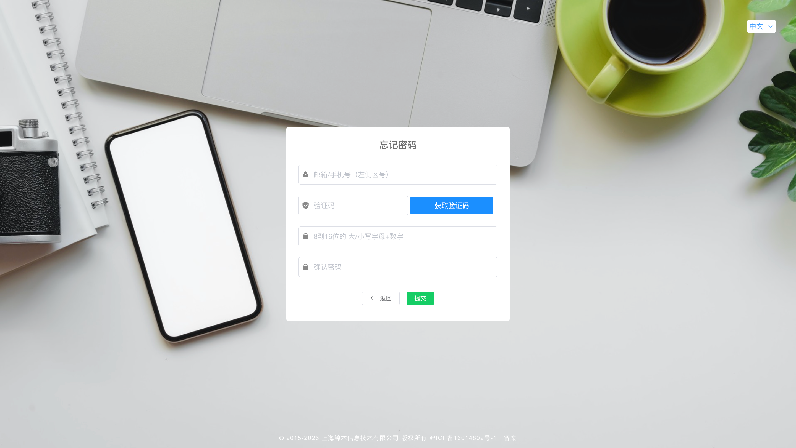

*图 1-2 重置密码页*

## 2 创建发信任务

任务管理用于创建国际及港澳台短信发送任务，并查看相关任务统计。

### 2.1 发信准备要求

| 项目 | 国际及港澳台发信要求 |
| --- | --- |
| From | 部分国家或地区须提前申请 |
| 短信签名 | 按目标国家或地区要求办理，由锦木通信服务团队后台绑定至用户账号。 |
| 收信号码 | 须包含相应国家或地区区号 |

部分国家或地区的申请要求见“接入信息表—表 2”。新增发送目的地前，建议联系锦木通信服务团队确认要求。

### 2.2 国际及港澳台发信

进入“任务管理 → 国际|港澳台发信”，按以下顺序填写任务：

1. **填写任务名称**：名称由用户自定义。
2. **填写 From**：确认目标国家或地区是否要求提前申请。
3. **准备短信内容**：可选择已添加的短信模板，系统会自动填入内容；也可直接输入发送内容。长短信会按相应计费标准拆分发送。
4. **选择编码类型**：默认选择 Unicode。Text 适用于 GSM 标准字符集内的内容，单条短信最多 160 个字符；Unicode 适用于中文及其他 GSM 标准字符集之外的内容，单条短信最多 70 个字符。
5. **设置手机号校验**：如需过滤黑名单号码，开启“手机号校验”。具体规则见 2.3 节。
6. **上传号码文件**：下载标准模板，填写包含区号的收信号码，再上传文件。异常处理见 2.4 节。
7. **选择发送时间**：选择立即发送或定时发送。操作限制见 2.5 节。

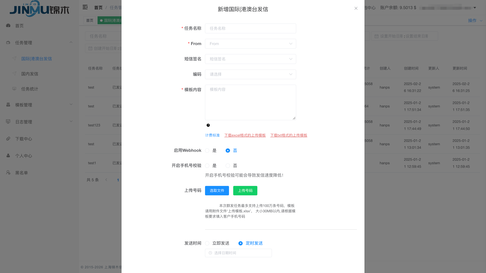

*图 1-3 国际及港澳台发信任务创建*

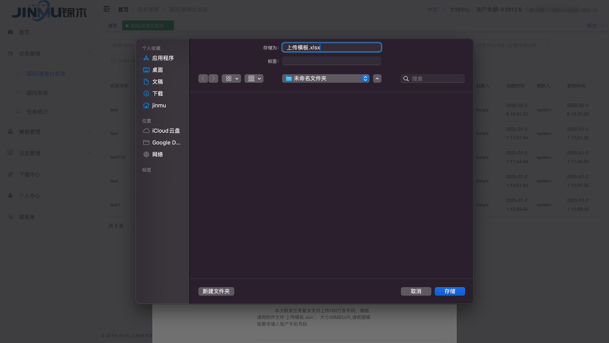

*图 1-4 号码上传模板下载*

### 2.3 手机号校验与黑名单

“开启手机号校验”用于对上传号码执行黑名单校验。请先在“黑名单”菜单中，针对对应的发信 Key 配置规则；命中的目标号码不会产生发信操作。配置方法见第 8 节。

**注意**：开启校验可能降低发送速度。若平台中未显示“黑名单”菜单，请联系锦木通信服务团队协助处理。该功能用于黑名单过滤，不代表验证号码真实存在或有效。

### 2.4 号码上传与异常处理

1. 下载平台提供的标准模板。
2. 按模板填写收信号码，并包含相应国家或地区区号。
3. 上传文件，查看数据检测结果。
4. 如提示“检测到异常数据 X 条”，下载《异常数据.xlsx》排查异常数据。

**号码有效性**：JMC 不检测收信号码是否真实存在或有效。通过上传检测不代表号码一定能够接收短信。

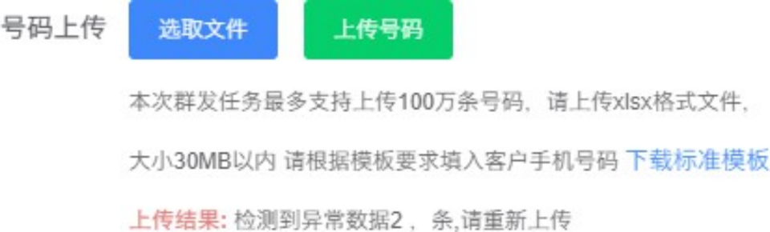

*图 1-5 号码检测异常提示*

### 2.5 发送时间与操作限制

- **立即发送**：立即创建任务并发送短信。
- **定时发送**：按用户设置的时间发送。在实际发送前，可以暂停任务后修改。

**发送限制**：任务开始发送后无法停止。提交前请核对收信号码、短信内容和发送时间。

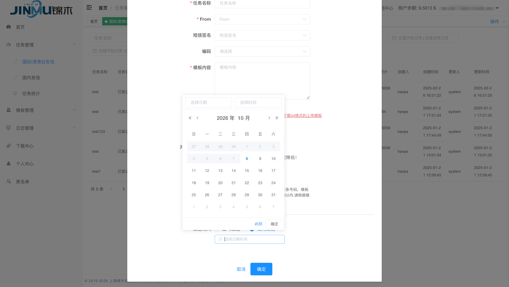

*图 1-6 定时发送日期与时间选择*

## 3 任务统计

任务统计以随机生成且唯一的任务 ID 为维度，查询通过 JMC 平台创建的发信任务。

**查询范围**：API 发信不提供任务统计。如需查询 API 发信记录，请进入“日志管理 → 日志查询”。

### 3.1 筛选与导出

页面默认展示该账号下的所有数据，可按任务状态、任务 ID、任务名称、国家名称和指定用户筛选。总览表导出格式为 `.xlsx`。

| 字段类别 | 导出字段 |
| --- | --- |
| 任务信息 | 任务ID、发送用户、任务名称、创建时间、发送时间、任务状态 |
| 发送统计 | 短信统计、已发送条数、成功条数、失败条数 |
| 费用信息 | 费用统计 |

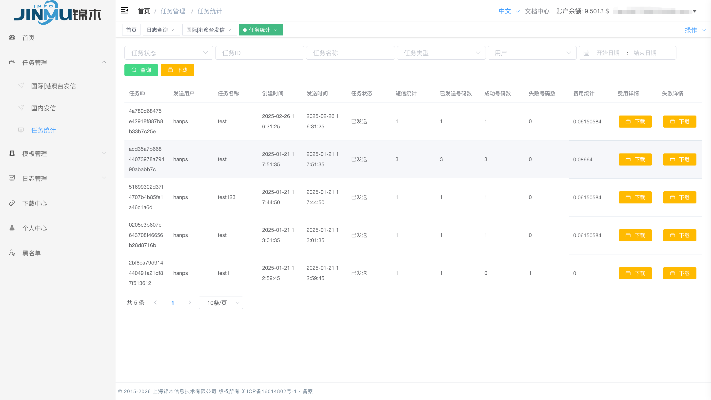

*图 1-7 任务统计与明细下载入口*

### 3.2 单个任务的明细

每条任务均可在当前页面单独下载“费用统计”和“失败详情”。费用统计表包含以下字段，字段名称按原导出表保留：

| 字段类别 | 导出字段 |
| --- | --- |
| 任务与号码 | TaskID、手机号码 |
| 发送记录 | 结果、发送时间、FROM、发送内容 |
| 目的地 | 国家地区名称、国家地区代码 |
| 费用 | 费用 |

## 4 模板管理

### 4.1 国际及港澳台短信模板

用户可以自行新增、删除、修改和查询国际及港澳台短信模板，以便重复使用短信内容。已添加的模板会关联至“国际|港澳台发信”任务页面，选择模板后自动填入内容。

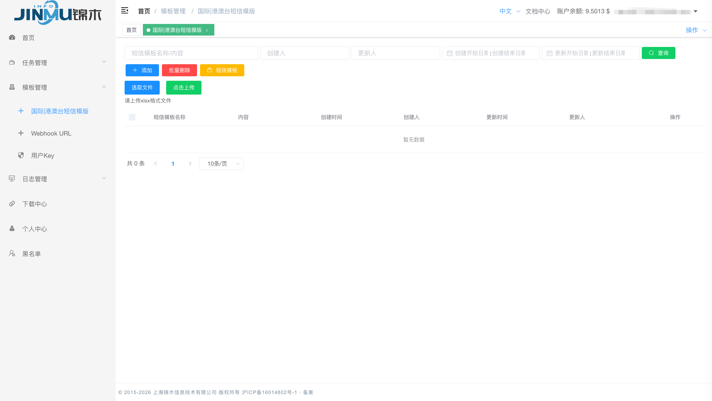

*图 1-8 国际及港澳台短信模板管理*

### 4.2 Webhook 配置

如需接收发信 Webhook，请联系锦木通信服务团队协助创建 Webhook URL。创建完成后，可进入“模板管理 → Webhook URL”编辑配置。

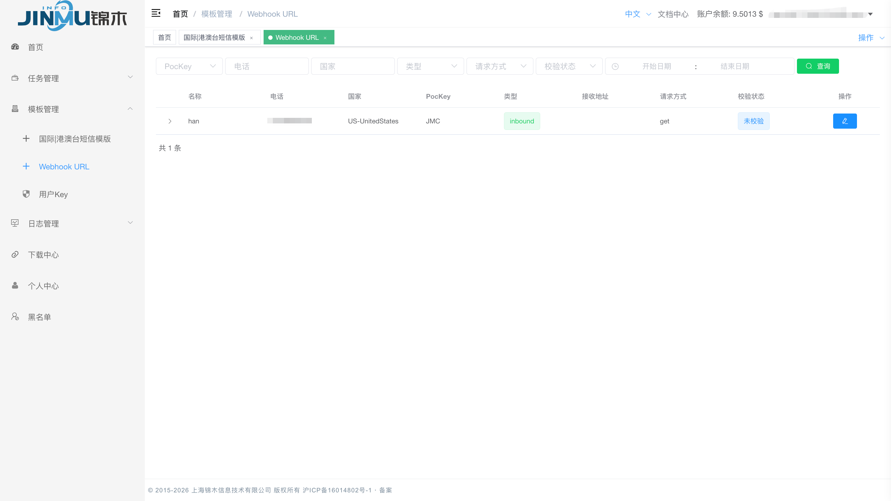

*图 1-9 Webhook URL 列表与编辑入口*

### 4.3 用户 Key

获取 API Key 配置信息。

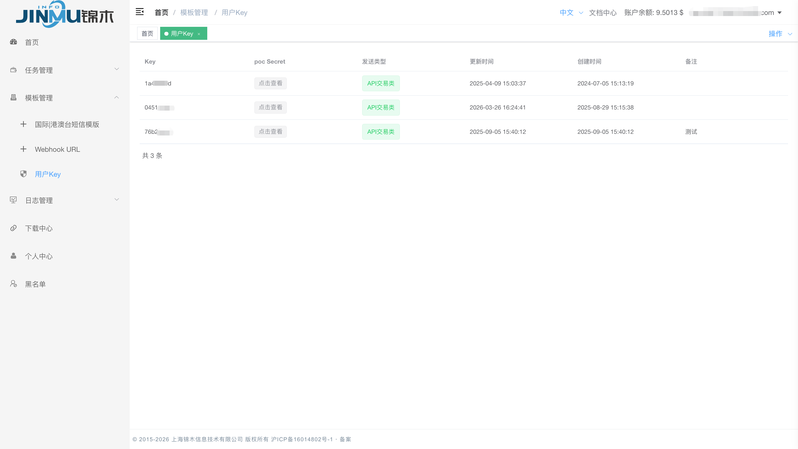

*图 1-10 获取 API Key*

**baseKey**：第一列的 Key 参数。

**secret**：点击“poc Secret”列的“点击查看”获取密钥信息。密钥信息可以配置多个。

**提示**：如果此页面查询不到任何 Key 信息，请联系锦木通信服务团队进行配置。

## 5 日志管理

### 5.1 日志查询

日志查询用于查看每一条短信的发信详情，支持营销类和交易类短信查询，以及 `.xlsx`、`.csv` 格式导出。

可用筛选条件包括：接收方手机号码、任务名称、国家名称、Message ID、任务 ID 和时间范围。

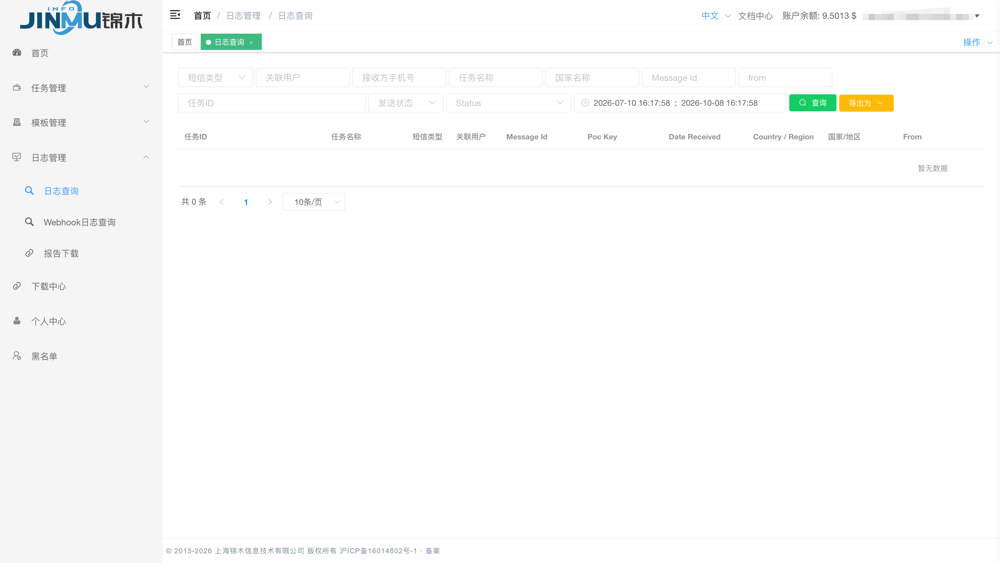

*图 1-11 短信日志查询与导出入口*

### 5.2 报告下载

报告下载用于导出统计数据：

1. 选择短信类型和时间范围。
2. 按需根据用户账户和国家筛选，国家支持多选。
3. 创建导出任务。
4. 进入“下载中心”，下载 `.xlsx` 格式的报告。

报告字段按原导出表保留：`Country / Region`、国家/地区、用户名、成功率、总计/条、成功/条、失败/条。

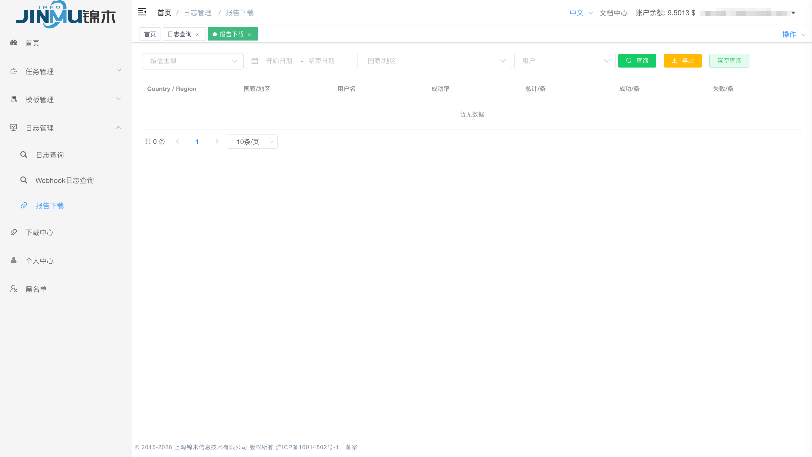

*图 1-12 报告查询与导出入口*

## 6 下载中心

下载中心集中提供以下导出任务的文件下载：

- “任务管理 → 任务统计”导出的总览表。
- “日志管理 → 日志查询”创建的导出任务。
- “日志管理 → 报告下载”创建的导出任务。

可根据导出类型和时间范围筛选记录，再下载相应文件。

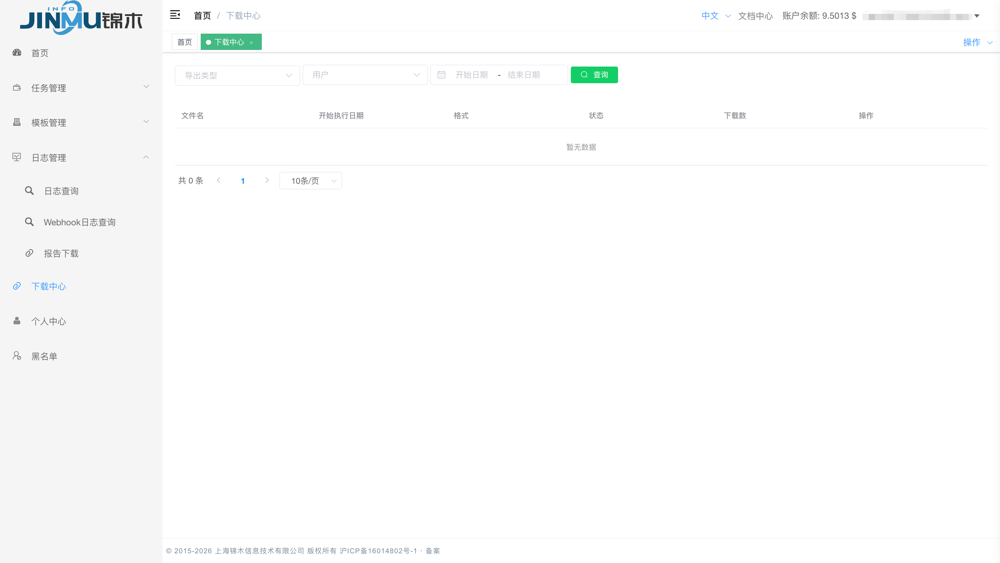

*图 1-13 下载中心*

## 7 个人中心

个人中心用于查看账号基础信息和修改账号密码。

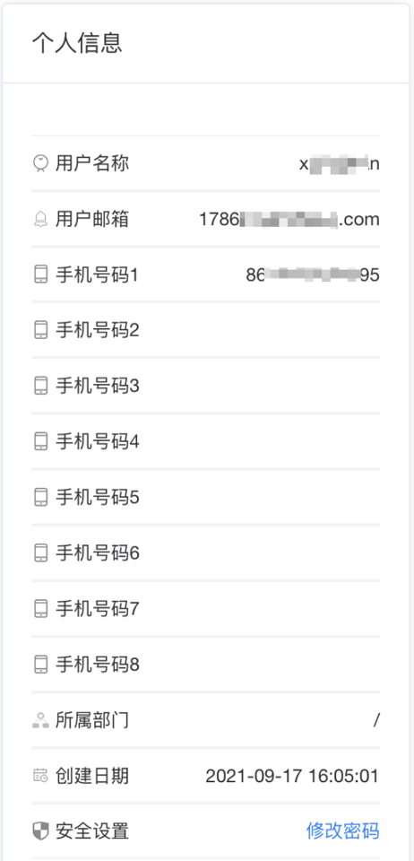

*图 1-14 用户账号基础信息*

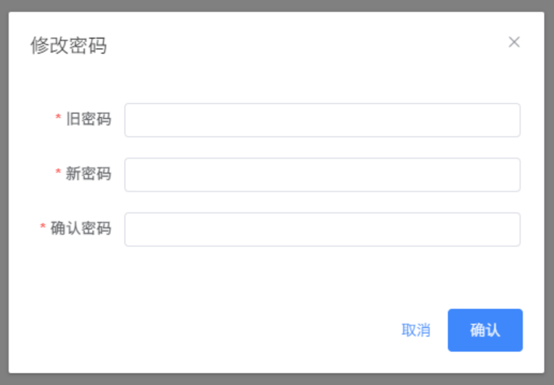

*图 1-15 修改密码*

## 8 黑名单管理

黑名单按指定的锦木 Key 配置，支持手机号和国家两种规则。目标号码命中号码黑名单或所属国家命中国家黑名单时，将被过滤，不产生发信操作。创建平台发信任务时，请结合“开启手机号校验”使用。

### 8.1 按手机号配置

1. 进入“黑名单”，选择“手机号”标签。
2. 点击“新增”，打开配置窗口。
3. 根据窗口提示完成配置。

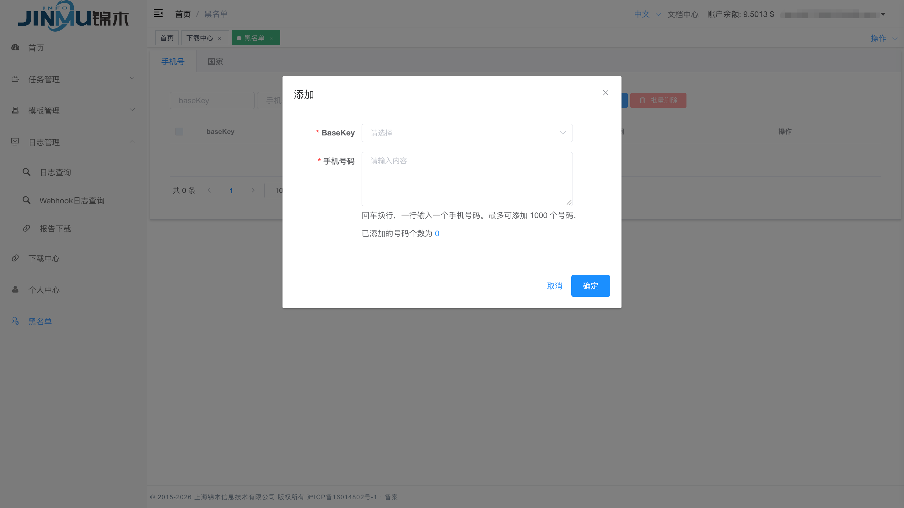

*图 1-16 按手机号配置黑名单*

### 8.2 按国家配置

1. 选择“国家配置”标签，点击“新增”。
2. 选择对应的锦木 Key。
3. 选择需要加入黑名单的国家。
4. 点击“确定”完成配置。

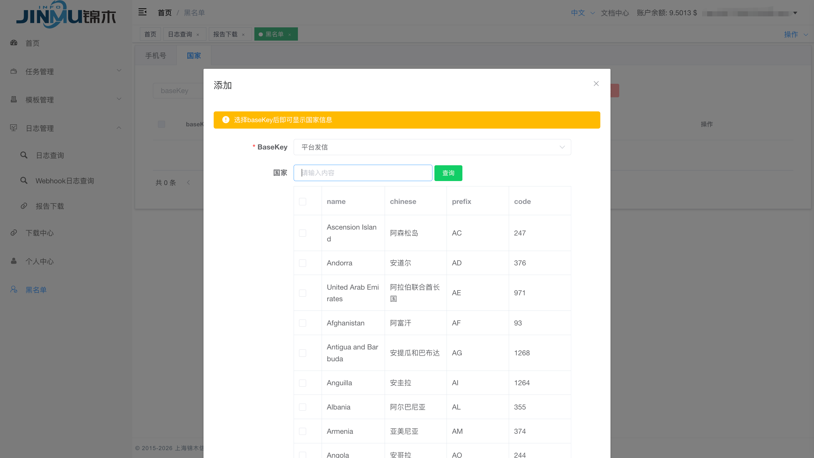

*图 1-17 按国家配置黑名单*
