# JMC 平台使用手册

账号登录 · 短信发送 · 任务统计 · 日志查询

> 适用平台： JMC 发信平台  
> 适用人员：通过网页平台发送短信和查询记录的用户  

本手册按平台功能介绍短信任务创建、模板管理、发送结果查询、日志导出及黑名单配置。操作入口和选项请以实际页面为准。

## 1. 登录与账号

### 1.1 登录前准备

平台入口：https://client.jinmuinfo.com

- **账号开通**：由锦木通信服务团队注册。手机号登录暂支持中国大陆、港澳台及新加坡号码。
- **初始密码**：注册后发送至注册邮箱。
- **验证码**：邮箱登录时发送至邮箱，手机号登录时通过短信发送，有效期为 **5 分钟**。

### 1.2 登录步骤

1. 打开登录页，选择邮箱登录或手机号登录。
2. 输入账号和密码。手机号登录时先选择区号，再填写手机号，无须重复输入区号。
3. 查收验证码，在有效期内完成登录。

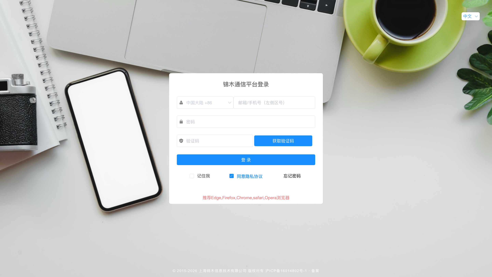

*图 1 · 平台登录页*

### 1.3 登录异常

**账号或密码有误**：检查账号、密码及手机号区号。仍无法登录时，使用“忘记密码”重置，或联系锦木通信服务团队。

**提示 `access for api meet limit`**：稍后再尝试登录。

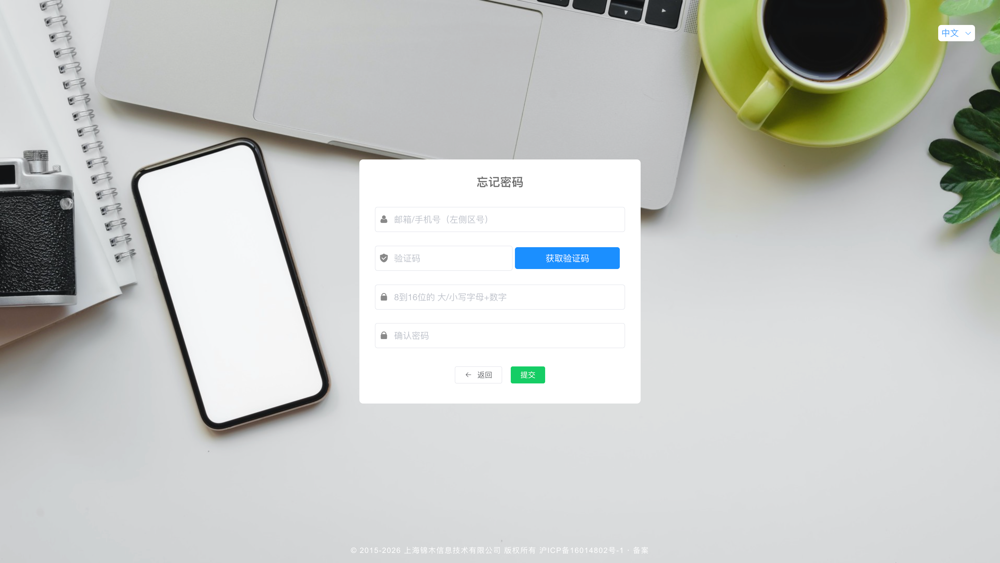

*图 2 · 重置密码页*

## 2. 创建发信任务

任务管理用于创建国际及港澳台短信发送任务，并查看相关统计。

### 2.1 发信准备

| 项目 | 填写或办理要求 |
| :--- | :--- |
| From | 部分国家或地区须提前申请 |
| 短信签名 | 按目的地要求办理，由服务团队后台绑定至账号 |
| 收信号码 | 包含相应国家或地区区号 |

新增发送国家或地区前，请联系锦木通信服务团队确认。

### 2.2 填写发送任务

进入 **任务管理 → 国际｜港澳台发信**，依次填写：

1. **任务名称**：自定义便于识别的名称。
2. **From**：填写发信人，确认目的地是否要求提前申请。
3. **短信内容**：选择已有模板自动填入，或直接输入正文。
4. **编码类型**：默认为 **Unicode**，按正文内容选择。字符限制见下方说明。
5. **手机号校验**：需要过滤黑名单号码时开启，规则见 2.3 节。
6. **号码文件**：下载标准模板，填写含区号的号码后上传，异常处理见 2.4 节。
7. **发送时间**：选择立即发送或定时发送，操作限制见 2.5 节。

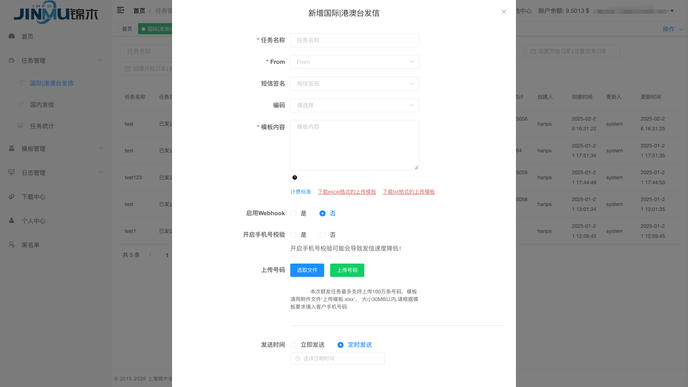

*图 3 · 发信任务创建页面*

| 编码类型 | 适用内容 | 单条短信上限 |
| :--- | :--- | :--- |
| Text | GSM 标准字符集内的内容 | 最多 160 个字符 |
| Unicode | 中文及 GSM 字符集之外的内容 | 最多 70 个字符 |

以上为单条短信上限。长短信拆分后，每段可容纳的字符数会减少；计数和费用以平台及相应计费规则为准。

### 2.3 手机号校验

“开启手机号校验”用于在短信发送前对目标手机号码进行有效性检查，通过号码格式及相关运营商信息，初步判断号码是否可用，减少因无效号码导致的发送失败。

开启校验可能会降低发送速度。

> **校验范围**
> 校验结果仅供参考，不保证号码一定能够成功接收短信，具体校验能力取决于目标国家及运营商的支持情况。

### 2.4 上传号码与处理异常

1. 下载平台提供的标准模板。

     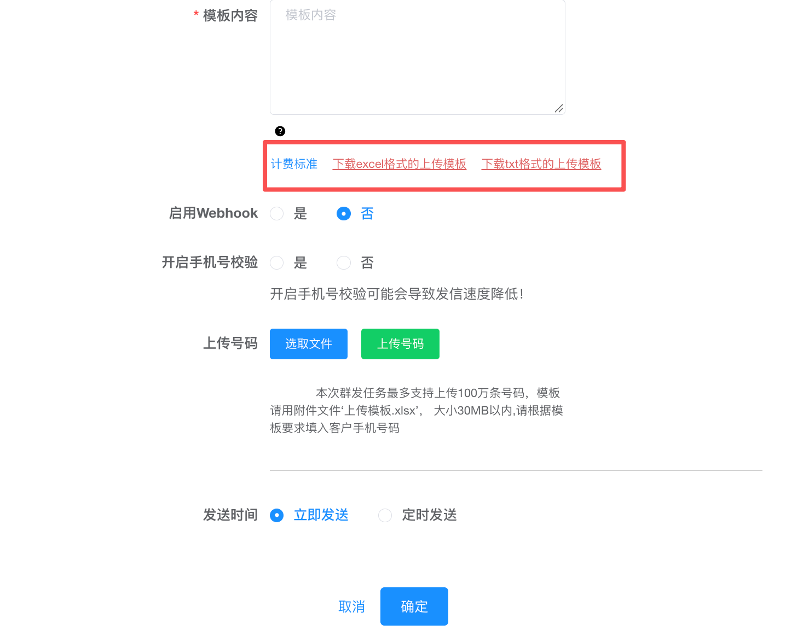  

     图 4 · 号码模板下载与文件选择

2. 填写包含国家或地区区号的收信号码。

3. 上传文件，查看数据检测结果。

4. 如提示“检测到异常数据 X 条”，下载《异常数据.xlsx》，排查后重新上传。

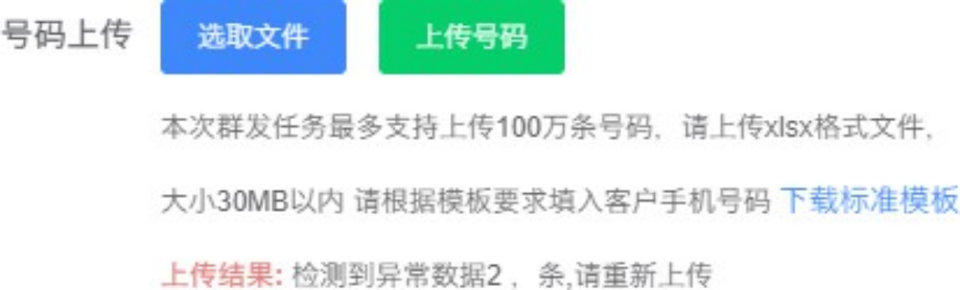

*图 5 · 号码上传异常提示*

JMC 不检测号码是否真实存在或有效。通过上传检测不代表号码一定能够接收短信。

### 2.5 发送时间与限制

- **立即发送**：创建任务后立即发送。
- **定时发送**：按设置时间发送；实际发送前，可暂停任务后修改。

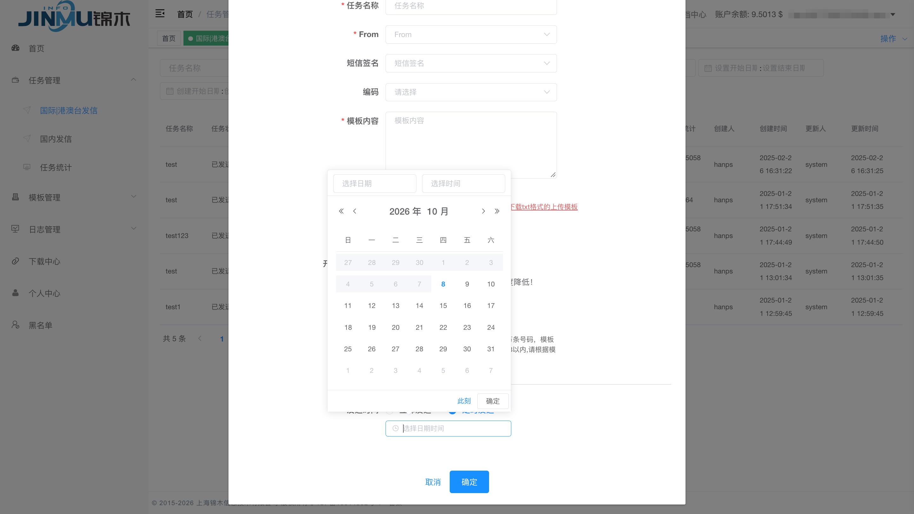

*图 6 · 定时发送设置*

> **提交前确认**  
> 任务开始发送后无法停止。提交前请核对号码、短信内容和发送时间。

## 3. 任务统计

### 3.1 查询与导出

任务统计以随机生成且唯一的任务 ID 为维度，查询通过 JMC 网页平台创建的发信任务。

1. 进入 **任务管理 → 任务统计**。
2. 按任务状态、任务 ID、任务名称、国家名称或指定用户筛选。
3. 查看发送结果，按需导出 `.xlsx` 格式的总览表。

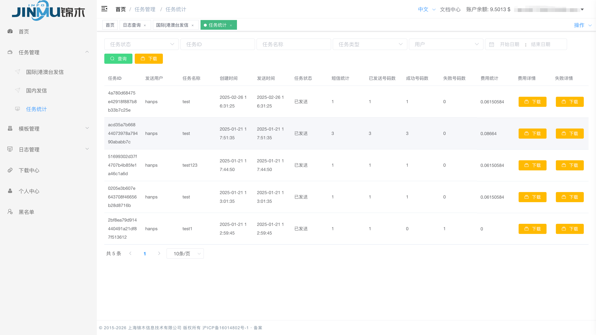

*图 7 · 任务统计与明细下载入口*

| 字段类别 | 导出内容 |
| :--- | :--- |
| 任务信息 | 任务 ID、发送用户、任务名称、创建时间、发送时间、任务状态 |
| 发送统计 | 短信统计、已发送条数、成功条数、失败条数 |
| 费用信息 | 费用统计 |

> **查询范围**  
> API 发信不提供任务统计。API 发信记录请在 **日志管理 → 日志查询** 中查看。

### 3.2 单个任务明细

每个任务可在当前页面单独下载 **费用统计** 和 **失败详情**。费用统计表字段如下，保留原导出字段名称：

| 字段类别 | 导出内容 |
| :--- | :--- |
| 任务与号码 | TaskID、手机号码 |
| 发送记录 | 结果、发送时间、FROM、发送内容 |
| 目的地 | 国家地区名称、国家地区代码 |
| 费用 | 费用 |

## 4. 模板与短信回执接口配置

### 4.1 短信模板

在国际及港澳台短信模板页面，可新增、删除、修改和查询模板。创建发信任务时选择模板，系统会自动填入短信内容。

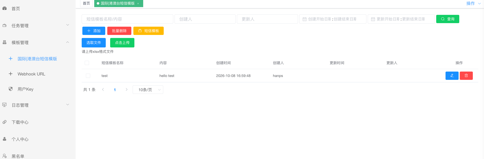

*图 8 · 短信模板管理*

### 4.2 Webhook URL

如需接收发信 Webhook，请联系锦木通信服务团队协助创建 URL。创建后，在 **模板管理 → Webhook URL** 中编辑配置。

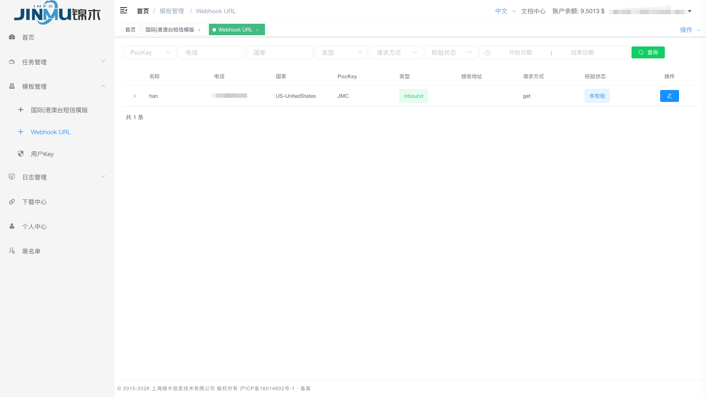

*图 9 · Webhook URL 配置*

### 4.3 用户 Key

在用户 Key 页面获取 API 配置信息：

- **baseKey**：第一列的 Key 参数。
- **secret**：在 **poc Secret** 列点击“点击查看”获取，支持配置多个密钥。

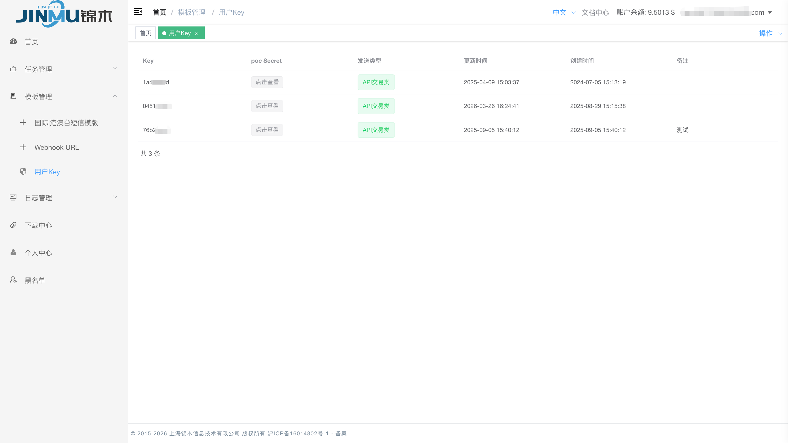

*图 10 · 用户 Key 与 Secret 查看入口*

若页面没有 Key 信息，请联系锦木通信服务团队配置。Secret 属于敏感凭据，应妥善保存。

## 5. 日志管理

### 5.1 日志查询

日志查询用于查看每条短信的发信详情，支持营销类、交易类短信查询及 `.xlsx`、`.csv` 导出。

1. 进入 **日志管理 → 日志查询**。
2. 按接收方号码、任务名称、国家名称、Message ID、任务 ID 或时间范围筛选。
3. 查看结果，按需创建导出任务。

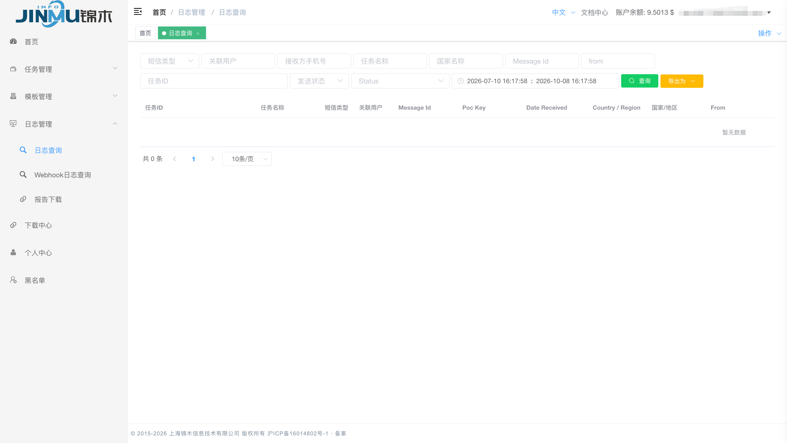

*图 11 · 短信日志查询与导出*

### 5.2 报告下载

1. 选择短信类型和时间范围。
2. 按需筛选用户账户和国家，国家支持多选。
3. 创建导出任务。
4. 在 **下载中心** 下载 `.xlsx` 报告。

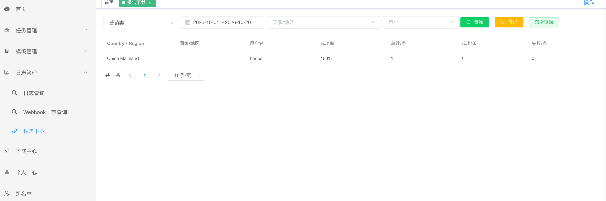

*图 12 · 统计报告查询与导出*

报告字段包括：`Country / Region`、国家/地区、用户名、成功率、总计/条、成功/条、失败/条，名称以导出表为准。

## 6. 下载中心

下载中心集中提供以下导出文件：

- **任务统计**：任务总览表。
- **日志查询**：短信明细导出文件。
- **报告下载**：统计报告。

按导出类型和时间范围筛选记录，再下载对应文件。

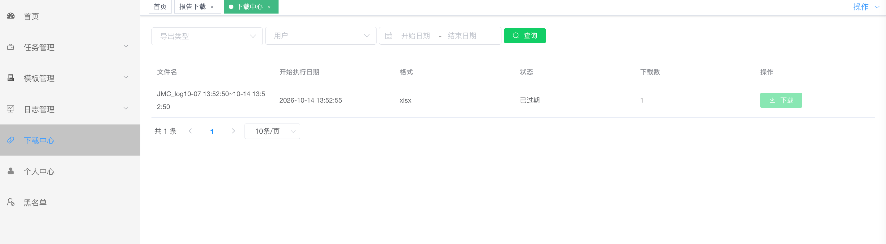

*图 13 · 下载中心*

## 7. 个人中心

个人中心用于查看账号基础信息和修改密码。

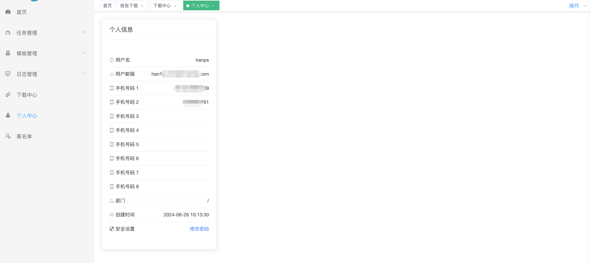

*图 14 · 账号基础信息*

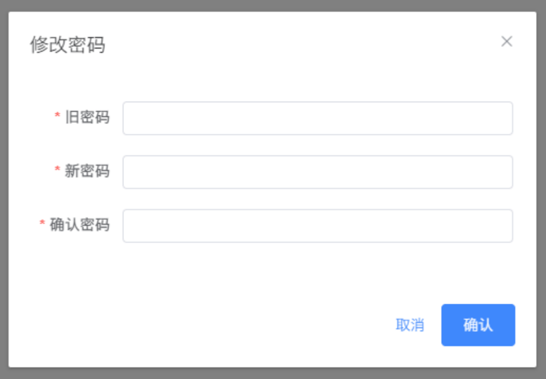

*图 15 · 修改密码*

## 8. 黑名单管理

黑名单按指定的锦木 Key 配置，支持手机号和国家规则。号码命中手机号黑名单，或所属国家命中国家黑名单时，会被过滤，不产生发信操作。

### 8.1 按手机号配置

1. 进入 **黑名单 → 手机号**。
2. 点击 **新增**。
3. 按窗口提示完成配置。

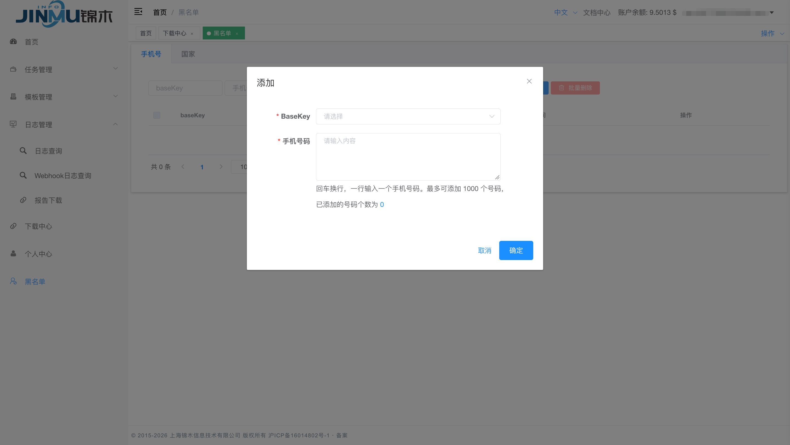

*图 16 · 手机号黑名单配置*

### 8.2 按国家配置

1. 选择 **国家配置**，点击 **新增**。
2. 选择对应的锦木 Key。
3. 选择需要加入黑名单的国家。
4. 点击 **确定**。

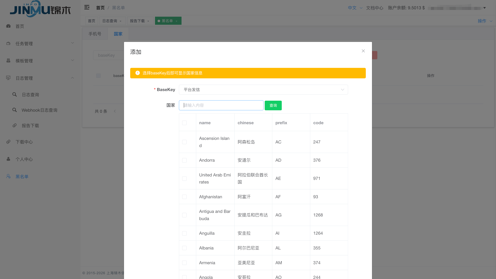

*图 17 · 国家黑名单配置*
