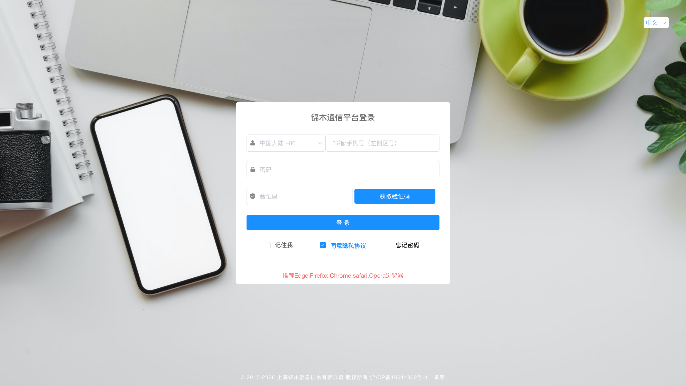
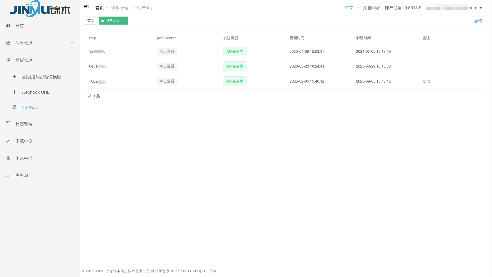
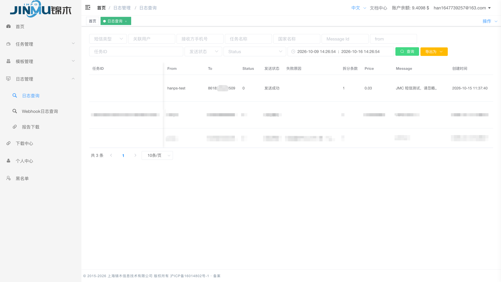

# API 发信快速开始

通过 JMC SMS API，使用 cURL 向测试号码发送一条短信。

## 1. 发送前准备

- 已开通 JMC 账号，账户余额充足。
- 准备好短信发送方的 **Sender ID**（品牌名称或公司简称，如 `Jinmu`），并已经和锦木团队确认可用于收件人所在国家或地区。
- 准备一个能查看收信结果的测试号码，包含国家或地区区号。

## 2. 获取凭据

1. 打开 JMC 发信平台：`https://client.jinmuinfo.com`，输入账号、密码，并按页面提示完成验证码登录。

    

    *图 1 · 填写账号、密码及验证码后登录。*

2. 进入 **模板管理 → 用户 Key**，获取凭据：

    - `baseKey`：第一列的 Key。
    - `secret`：在 **poc Secret** 列点击“点击查看”。

    若没有 Key 信息，联系锦木通信服务团队配置。

    

    *图 2 · 复制对应的 Key，并在同一行点击查看 Secret。*

## 3. 发送请求

在终端执行下面的命令。执行前替换 `YOUR_BASE_KEY`、`YOUR_SECRET`、`YOUR_APPROVED_FROM` 和 `852XXXXXXXX`；号码必须是实际测试号码。

```bash
curl --request POST "https://sms.jinmuinfo.com/send/json" \
  --header "Content-Type: application/json" \
  --data '{
    "baseKey": "YOUR_BASE_KEY",
    "secret": "YOUR_SECRET",
    "from": "YOUR_APPROVED_FROM",
    "msg": "JMC 短信测试，请忽略。",
    "to": "852XXXXXXXX",
    "type": "unicode"
  }'
```

接口使用 **POST + JSON**，请求头设置为 `Content-Type: application/json`。以下参数均放在 JSON 请求体中，值均使用字符串。

| 参数 | 重点说明 |
| :--- | :--- |
| `from` | 填写短信发送方的 **Sender ID**。可使用品牌名称或公司简称，例如 `Jinmu`，方便收件人识别。 |
| `msg` | 输入要发送的短信内容。 |
| `to` | 一个实际收件号码，包含国家或地区区号 |
| `type` | 正文都在 GSM 字符集内时选 `text`。包含中文或 GSM 字符集之外的字符时选 `unicode`。 |

## 4. 确认结果

成功响应示例：

```json
{
  "msg": "发送成功!",
  "code": 0,
  "data": true,
  "messageID": "YOUR_MESSAGE_ID"
}
```

- `code=0` 表示接口返回业务成功，保存 `messageID`，并确认测试手机实际收到短信。
- `code` 非 `0` 时，查看 `msg`；认证问题优先核对 Key、Secret 和 Key 状态。
- 未收到短信时，在 **日志管理 → 日志查询** 按消息 ID 或号码查看记录。



*图 3 · 本次 API 发信日志显示“发送成功”，可核对收件号码、拆分条数及短信内容。*

更多说明请查看 [API 接入手册](api.md)。
