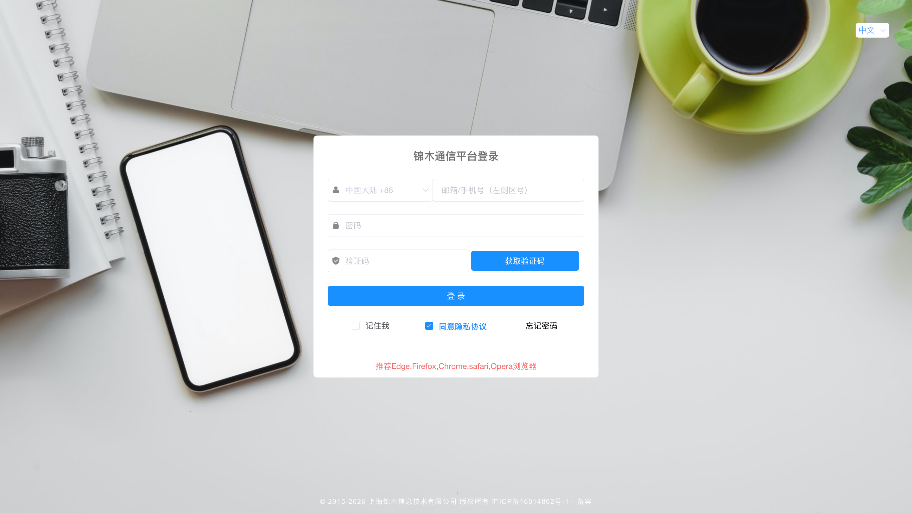
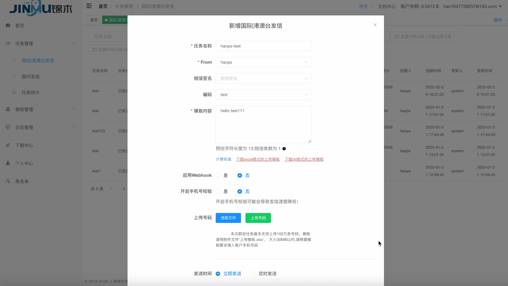
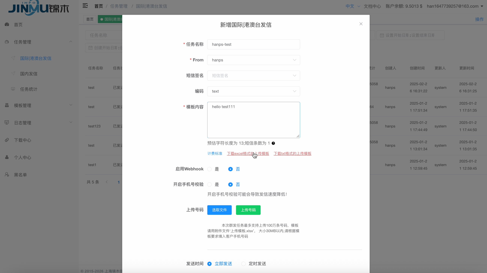
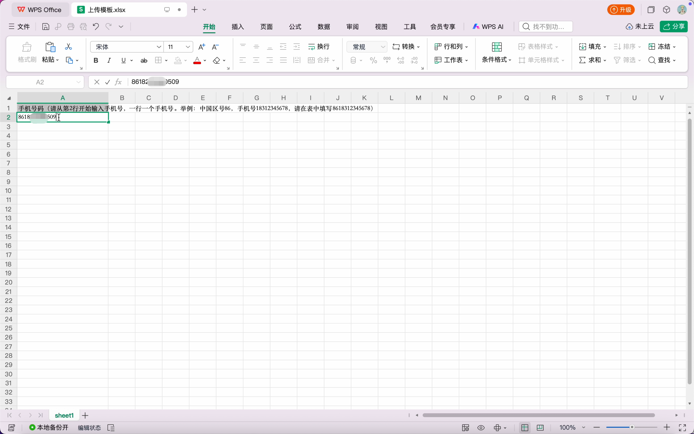
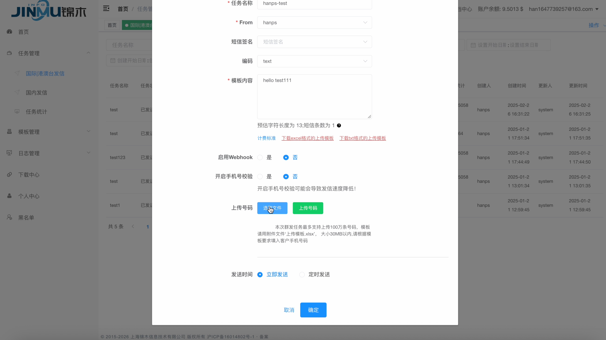
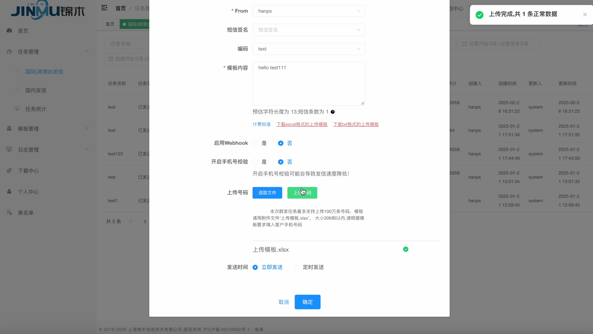
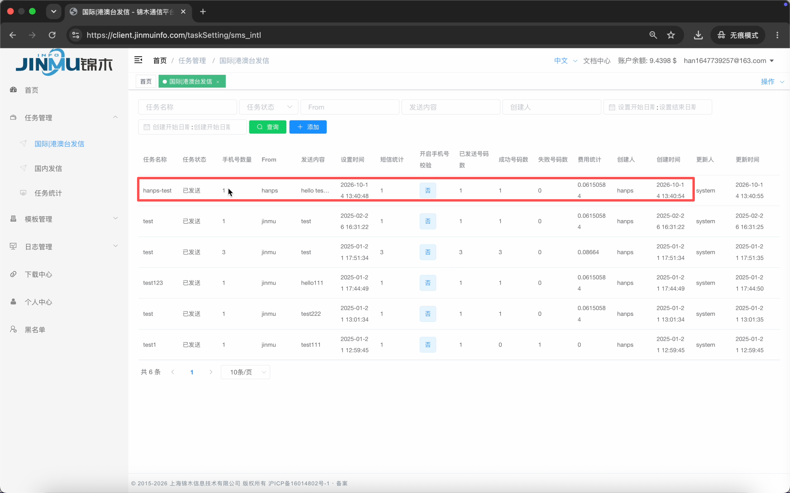
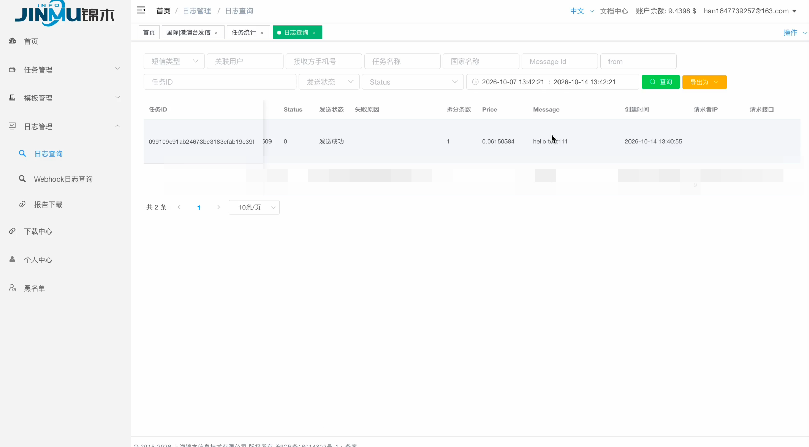

# 平台发信快速开始

通过 JMC 网页平台向测试号码发送一条短信。

## 1. 发送前准备

- 已开通 JMC 账号，账户余额充足。
- 准备好短信发送方的 **Sender ID**（品牌名称或公司简称，如 `Jinmu`），并已经和锦木团队确认可用于收件人所在国家或地区。
- 准备一个能查看收信结果的测试号码，包含国家或地区区号。

## 2. 通过网页平台发送

想跟着演示操作请参考视频 [短信发送视频](video-tutorial.md#_2)。

1. 打开 JMC 发信平台：`https://client.jinmuinfo.com`，输入账号、密码，并按页面提示完成验证码登录。

    

    *图 1 · 填写账号、密码及验证码后登录。*

2. 进入 **任务管理 → 国际｜港澳台发信**，新增任务。
3. 填写发送信息：

    | 项目 | 填写说明 |
    | :--- | :--- |
    | 任务名称 | 填写任务名称，给本次发送取个名字，方便查找，例如 `test-1`。 |
    | From | 填写短信发送方的**Sender ID**。可使用品牌名称或公司简称，例如 `Jinmu`，方便收件人识别短信发送方。 |
    | 短信签名 | 可选项: 如已配置，可选择短信签名，自动填入对应的短信内容。 |
    | 短信内容 | 输入要发送的短信内容。 |
    | 编码 | 正文都在 GSM 字符集内时选 `text`。包含中文或 GSM 字符集之外的字符时选 `unicode`。 |
    | 发送时间 | 现在发送选“立即发送”；指定时间发送选“定时发送”。 |

    

    *图 2 · 发信任务填写位置，正文下方提供号码模板下载入口。图中使用英文正文和 Text 编码；按本文发送中文测试短信时，请选择 Unicode。*

4. **下载号码上传模板**：

    - 在短信正文输入框下方，点击 **下载excel格式的上传模板**。
    - 将 `上传模板.xlsx` 保存到本地。
    - 页面也提供 **下载txt格式的上传模板**，使用其中一种格式即可；本次示例采用 Excel。

    

    *图 3 · 点击“下载excel格式的上传模板”，保存号码模板到本地。*

5. **填写并保存模板**：

    - 打开下载的模板，保留第 1 行说明。
    - 从 **A2 单元格（第 2 行）** 开始，**一行填写一个手机号**，号码需包含国家或地区区号。
    - 每个任务建议最多填写 **15 万个号码**，填写完成后保存为 `.xlsx` 文件。

    

    *图 4 · 保留第 1 行说明，在第 2 行填写测试号码后保存。*

6. **选择并上传文件**：

    - 回到 JMC 平台任务页面，在 **上传号码** 区域点击 **选取文件**。
    - 选择刚保存的 Excel 文件。
    - 点击绿色的 **上传号码** 按钮，开始上传。

    

    *图 5 · 先点击“选取文件”选择本地模板，再点击右侧“上传号码”。*

7. **确认上传结果**：

    - 等待页面提示 **上传完成，共 1 条正常数据**，并确认文件旁出现成功标记。
    - 如提示异常数据，下载《异常数据.xlsx》，按提示修正后重新上传。

    

    *图 6 · 点击“上传号码”后，右上角提示“上传完成，共 1 条正常数据”，文件旁显示绿色成功标记。*

8. **提交发送**：确认 **发送时间 → 立即发送**，点击底部 **确定** 提交任务。任务开始发送后无法停止。

9. **先查看当前任务状态**：

    - 按任务名称和创建时间，找到刚提交的任务。
    - 查看 **任务状态、已发送号码数、成功号码数和失败号码数**。

    

    *图 7 · 在当前发信页面找到本次任务。*

10. **再查询短信日志**：

    - 进入 **日志管理 → 日志查询**。
    - 按本次任务名称、任务 ID 或接收方手机号筛选，时间范围应覆盖发送时间。
    - 点击 **查询**，查看对应记录的 **发送状态、失败原因、拆分条数和短信内容**。
    - 确认测试手机实际收到短信。

    

    *图 8 · 本次任务的短信日志显示“发送成功”；如发送失败，查看同一行的失败原因。*

更多说明请查看 [平台操作指南](platform-usage.md)。
